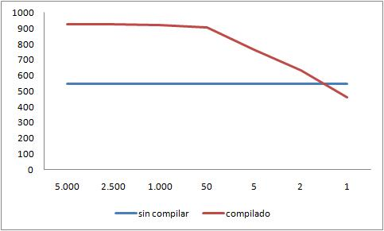

It's easy to fool yourself when trying to optimize. What seems logical, and
even numerically plausible, can blow up in our faces when
[we analyze it in detail](/blog/2009/08/enganos-numericos.html),
especially when we put it to the test in practice.

It's typical for some expert to advise us to use a certain technique
because in theory it's more optimal. Novices tend to apply these
proposals without questioning them much. We older hands tend to trust
experience, and experience usually proves us right.

That's what happened to Jeff Attwood, who in a
[really brilliant post](http://www.codinghorror.com/blog/2010/03/compiled-or-bust.html)
shows that the expert was wrong, and that what practice was
telling him had a basis after all. And the problem Attwood
explains is interesting, because I've run into the same one several times,
even recently.

It goes more or less like this, [according to an
expert](http://weblogs.asp.net/omarzabir/archive/2008/10/28/solving-common-problems-with-compiled-queries-in-linq-to-sql-for-high-demand-asp-net-websites.aspx)
quoted by Attwood

> "If you are building an ASP.NET web application that's going to get
> thousands of hits per hour, the execution overhead of Linq queries
> is going to consume too much CPU and make your site slow. There's a
> runtime cost associated with each and every Linq
> Query you write. The queries are parsed and
> converted to a nice SQL Statement on every hit. It's not done at
> compile time because there's no way to figure out what you might be sending
> as the parameters in the queries during runtime."

Although Jeff Attwood is talking about Linq and ASP.Net, the problem can
be extrapolated to other environments, like PHP or Java, where we have
queries that are interpreted at runtime.

Linq's mechanism is quite elegant and, in my opinion, more powerful than
other ORMs. In the particular case the author presents there is a
Linq query more or less like this

```csharp
    var query = from widget in dc.Widgets
    where widget.ID == id && widget.PageID == pageId
    select widget;
    var widget = query.SingleOrDefault();
```

The expert states that he was analyzing the problem with this kind of
execution and discovered that executing this kind of statement dwarfs
the time spent on the *roundtrip* to the database!!

That is, apparently more time is spent parsing these Linq
statements than executing the resulting code in the database. So
what you have to do, he recommends, is compile these
queries before executing them (something that complicates the code quite a bit, and
makes maintaining it a harder task).

You can imagine the face Jeff Attwood made when he read these
claims:


Because he simply couldn't believe it. In fact, the Stack Overflow site,
with over 1.6 million page views a day, has many lines of
code that depend on Linq statements like the ones questioned by Omar Al
Zabir, the MVP expert, [author of books on the
subject](http://www.amazon.com/dp/0596510500?tag=wwwoazabircom-20&camp=14573&creative=327641&linkCode=as1&creativeASIN=0596510500&adid=1WQZNVWKP6R3WW52QEW1&).

And to give his argument more weight, Omar Al Zabir shows data from
[Rico Mariani](http://blogs.msdn.com/ricom/default.aspx), a Microsoft
engineer who ran a series of experiments testing the
performance of compiled Linq statements versus uncompiled ones.

This is the table Al Zabir shows, taken from the article with [Rico
Mariani's
experiments](http://blogs.msdn.com/ricom/archive/2008/01/14/performance-quiz-13-linq-to-sql-compiled-query-cost-solution.aspx):


**But there's a little catch.**

To understand why Omar Al Zabir's claims don't square with
Attwood's experience, you have to understand how the tests were done, and
then we can see that Al Zabir makes a serious mistake, generalizing a
solution that is highly dependent on the kind of operation we are going to
perform.

Rico Mariani explains that to compare the two kinds of queries he
basically ran these two tests:

For the precompiled queries:

```
start timer
for (j=0;j\<batches;j++)
    compile query

for (i=0;i\<runs;i++)
    create new data context
    run query in new context

stop timer
print number of selects and time etc.
```

For the interpreted (not precompiled) queries:

```
start timer

for (j=0;j\<batches;j++)
    for (i=0;i\<runs;i++)
        create new data context
        run query in new context
 stop timer
 print number of selects and time etc.
```

And what Rico Mariani does is play with the number of runs
and the size of the batch, which produces a much longer table of
results, one that has at the end some results that
are ignored by Al Zabir (we don't know whether intentionally). These
results ignored by the "expert" are:

> Testing 2500 batches of 2 selects 5000 selects uncompiled 9165.0ms
> 25000 records total 545.55 selects/sec\
> 5000 selects compiled 7892.0ms 25000 records total 633.55 selects/sec\
> Testing 5000 batches of 1 selects\
> 5000 selects uncompiled 9157.0ms 25000 records total 546.03
> selects/sec
>
> 5000 selects compiled 10825.0ms 25000 records total 461.89 selects/sec

You're surely dizzy by now, but let me sum it up for you:

At the start of the experiment, the test is 1 batch of 5,000 selects. In the
compiled case you get 925 selects/second, and uncompiled 543 selects
per second. Winner: the compiled version.

At the end of the experiment, the test is 5,000 batches of 1 select. In the
compiled case you get 461 selects/second and uncompiled you get
546 selects/second.

In fact, if we plot batch size against performance in
selects/second, what's going on becomes clear:



What does this mean?

It turns out we're looking at the two extremes of possible
applications. Attwood's application is a web application, heavily
**transactional**; that is, it sits at the extreme of 5,000 batches of
size 1. On the other hand, Omar Al Zabir's recommendations are useful
when the batch size is large (batches of 5,000 or more selects). Al
Zabir's recommendations are very useful when we're dealing with
**batch**, offline, non-transactional applications.

That is the particular case of the applications I have to
deal with at work: batch applications, processing thousands or
millions of records, the exact opposite of transactional web
applications. In my case Al Zabir's advice could
apply (if I used Linq).

Does this apply to the debate over compiled languages
versus interpreted languages? Or to other cases, like
using an ORM versus direct calls to the database with JDBC,
for example? I suspect so, but it's a claim that, as always,
needs to be demonstrated, and for that you have to show the code.

References:

-   [Compiled or Bust](http://www.codinghorror.com/blog/2010/03/compiled-or-bust.html)
-   [Solving common problems with Compiled Queries in Linq to Sql for
    high demand ASP.NET
    websites](http://weblogs.asp.net/omarzabir/archive/2008/10/28/solving-common-problems-with-compiled-queries-in-linq-to-sql-for-high-demand-asp-net-websites.aspx)
-   [Performance Quiz \#13 \-- Linq to SQL compiled query cost \--
    solution](http://blogs.msdn.com/ricom/archive/2008/01/14/performance-quiz-13-linq-to-sql-compiled-query-cost-solution.aspx)
