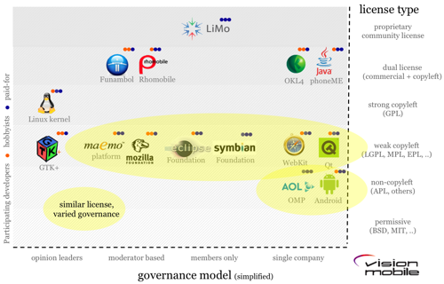

In 2009 Andreas Constantinou questioned the notion of open source in his
article "[Open is the new closed"](http://www.visionmobile.com/blog/2009/08/open-is-the-new-closed/),
analyzing in detail a fact
we've discussed before: releasing the code isn't enough; control over
how an open software product is developed is as important as, or more
important than, having the source code.

The word open comes across as something positive. The same thing happens with it
as with the word transparency: both are pretty words that signal
good intentions. Everyone promises openness, transparency; they even set up
commissions and publish a page on their website with transparent
information, but deep down what we all expect when people talk about
transparency isn't delivered. The word itself becomes meaningless and we
feel cheated.

Something similar happens with open software, open source, and free
software: over time we realize they aren't that free, and they
aren't that open.

Because if we look at the big projects, the successful free
software projects, they have behind them the backing of big companies, or
conglomerates of companies with very specific interests in controlling
these products, so they're free to the extent that the sponsors
allow it.

Consider the case of Java or MySQL, which seem to be under threat
right now because they're under the control of a single big sponsor, like
Oracle.

It's entirely fair to think that the future of these projects is
threatened when their control, their governance, has fallen into the hands
of a company that operates quite aggressively in the market.

There have been problems with IBM and the patents it promised not to use against
the open source community, the moment it saw its mainframe
business threatened.

The reason for these problems is that open source licenses only
tell half the story, as Constantinou rightly points out.

Licenses govern control of the source code. But in the
mobile industry, for example, the source code and the products are two
very different things. For example, although you can play with Android's
source code, do you know whether the latest updates to the code
are visible? Who decides what goes into the latest release of
Symbian? You can create your own browser based on WebKit, but why
is it so hard for your contributions to the source code to make it to the top
of the tree?

The other half of the open source story is the project's governance
model, which is what Constantinou talks about.

Every open source project must have a governance model. The
linux kernel itself has a process for deciding what goes into the main
branch of the source.

Constantinou's company, [vision
mobile](http://www.visionmobile.com/), has mapped this out in this chart:

The vertical axis represents the type of license, from the most
permissive to the most proprietary (all of them are open source
licenses). The horizontal axis shows one variable of the governance model,
which has to do with control of the main branch of the code and whether
it is controlled by individuals, moderators, a closed club or a
specific company. For example, in the case of the linux kernel,
control is exercised by a group of opinion leaders (Torvalds and his
lieutenants); in the case of Java and Android, there is a single company that
decides what finally goes into the main branch of the code.

On the map, next to each project, there are some colored dots that tell
us what proportion of these projects' developers are
paid to work on them. For example, in the linux kernel 2/3
are paid (that is, 2/3 of the linux kernel developers
receive a salary to devote themselves to contributing to this project).

What an interesting map this is. It's very revealing.

What Constantinou discovered is that:

-   Open source licenses (the large print that covers control of
    the sources) are widely used, converge and are well understood

-   Governance models (the fine print that controls the product) are
    proprietary, diverge and are very poorly understood.

This matters, because if we aren't shown how the
development of a product is governed, however open its
code may be, most likely its development model, its governance, is
totally closed, and deep down we are being fooled. In reality
open is closed, and that's not a paradox.
