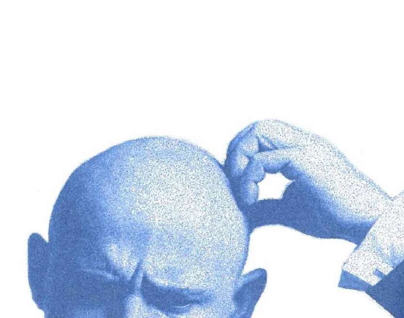

Ask anyone why we have summer and winter and they will probably(\*)
answer, fully convinced, that it happens because the Earth has an
elliptical orbit, so in summer it is closer to the sun and in winter it
is farther away. The worst part is that this is probably what they were
taught in school!

If that happens, ask that person to explain why it is winter in one
hemisphere while, at the same time, it is summer in the other.
**TILT!**

This is an example of the complete disconnect between intelligence,
education and understanding.

A lot of people seem to be in this situation: they were taught that the
seasons come from the orbit and the Earth-sun distance, but they were
also taught that when it is winter in the northern hemisphere it is
summer in the southern hemisphere, and they are unable to notice the
contradiction. They were obviously taught something wrong (and worse,
the mistake is still being taught), but they don't notice.

How many other things have we been taught, and accepted for years as
absolute truths, that are completely wrong? How many things do we never
bother to check for contradictions? How many contradictory teachings
have we received and still fail to question?

Frank Herbert said that *"intelligence is the poor relation of
understanding"*.

Improving education is not enough. It is time to start understanding.

(\*) apparently there is a study showing that 60% of people make this
mistake, but I can't find the source.

(\*\*) the reason for winter and summer is the tilt of the Earth's axis
(23.5 degrees).
