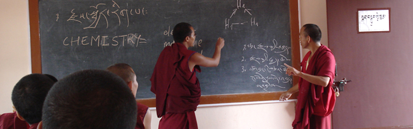
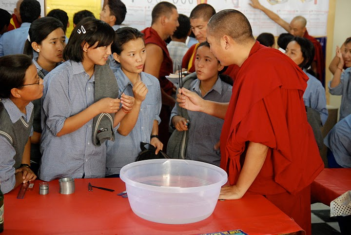

While looking for pictures of Tibetan monks to go with the story I
[published today on akarrú](https://www.akarru.com/blog/2010/05/23/los-nueve-mil-millones-de-nombres-de-dios/),
I came across the site [Science For Monks](http://scienceformonks.org/),
an initiative promoted by the Dalai Lama to teach science to Tibetan
monks.

The program continues the line the Dalai Lama started with his dialogue
with modern scientists. I remember Francisco Varela's book **"Sleeping,
Dreaming, and Dying"**, which collects one of the early conferences
debating Buddhism and science. One of the things that struck me most was
that the Dalai Lama was asked whether a soul could be reincarnated in a
machine, and he answered that if the machine was capable of hosting
consciousness, Buddhism did not rule out the possibility.

It is an interesting initiative: the monks get trained in science and
help spread it in their communities.

I imagine Francisco Varela would be happy to see this picture:

