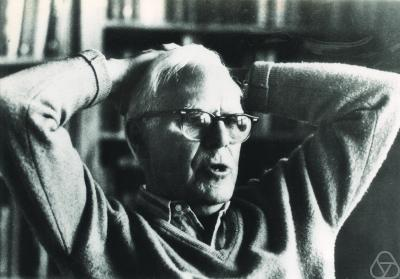

 
Martin Gardner died yesterday at the age of 96. For those who don't know
him, Gardner was a great science popularizer, famous for his column on
recreational mathematics published in Scientific
American.

His main contribution was his lifelong fight against pseudoscientific
fraud. [James Randi](/en/blog/lnds/2010/05/23/james-randi-a-lesson-in-skepticism/)
pays him [a heartfelt tribute on his blog](http://www.randi.org/site/index.php/swift-blog/995-my-world-is-a-little-darker.html).
He is without doubt a great loss for science outreach and for the
skeptical movement.

I leave you with a video, an episode of 
"[The Nature of Things](http://www.cbc.ca/documentaries/natureofthings/)" (the TV show that inspired the name of this blog), where [David
Suzuki](http://www.davidsuzuki.org/) shows us Gardner's world, and
his importance for the popularization of science, mathematics and
rational thinking:


[The Nature of Things / Martin Gardner](http://vimeo.com/7176521) from
[Wagner Brenner](http://vimeo.com/wbrenner) on
[Vimeo](http://vimeo.com).
