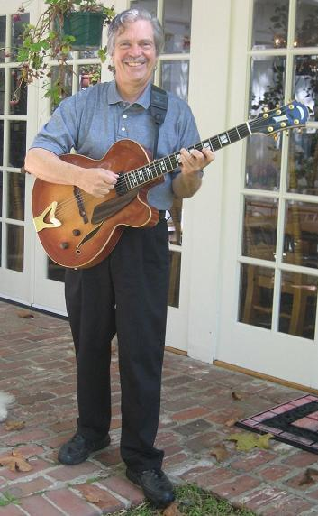

On May 17, 2010 Alan Kay turned 70, and his friends gave him
[a book of essays](http://vpri.org/pov/), written by friends of his and
by people who have worked with him in different fields. Alan Kay is a
true polymath, an artist in the sense described by 
[Leon Battista Alberti](https://es.wikipedia.org/wiki/Leon_Battista_Alberti): 
*"... the
artist in this social context must not be a mere craftsman, but an
intellectual trained in every discipline and every field."*

Alan Kay said "the best way to predict the future is to invent it", and
he invented the laptop, the graphical user interface (GUI), the direct
manipulation metaphor and object-oriented programming. He was one of the
most important researchers at Xerox PARC, and the man Steve Jobs wanted
to hire to revolutionize the personal computer market.

Alan Kay studied mathematics and molecular biology in the 1960s, and
while he studied he worked as a **professional jazz guitarist**. In 1966
he started studying computer science, and it was that year, on November
11, 1966 (the day I was born), that Alan Kay had a mysterious epiphany
that led him to develop the concept of object-oriented programming ([a
term he
coined](http://userpage.fu-berlin.de/~ram/pub/pub_jf47ht81Ht/doc_kay_oop_en)):

> "In 1966, the thing that knocked me over was that
> [Sketchpad](http://en.wikipedia.org/wiki/Sketchpad) was maintaining
> dynamic relationships. That's the key to building large system. The
> other thing that happened in 1966 was thinking about the ARPANet. The
> idea of having a million machines without any central control. Simula
> provided a programming form of what SketchPad was doing. My background
> in biology and math led me to think about algebra and tissues.
> [Barton](http://en.wikipedia.org/wiki/Robert_S._Barton) taught me
> "The basic principle of recursive design is making the parts as
> powerful as the whole." These ideas led me to an insight on November
> 11, 1966: the timesharing people got it right with processes, but it
> was too big.
>
> The interesting thing about the object idea is that it's everywhere.
> The perversity of science is that world doesn't change just because we
> get a different perspective of it.
>
> The secret of PARC's success was to design the best virtual machine we
> could and then to build hardware that optimized that. We've got that
> concept backwards today." (taken [from this transcript of a talk by
> Alan
> Kay](http://www.windley.com/archives/2006/02/alan_kay_is_com.shtml))

Alan Kay is perhaps one of the most revolutionary figures in computing.
If you have some time, I suggest reading [the
essays](http://piumarta.com/pov/points-of-view.pdf) his friends wrote
about him. There are people like the music producer Quincy Jones, Vint
Cerf (one of the fathers of the internet), Nicholas Negroponte, Ivan
Sutherland, John Sculley and several other important figures who have
had the chance to work with this great man.
