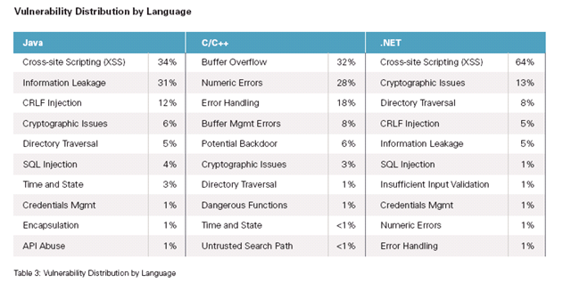

 
A recent study by Veracode states that **"the vulnerability density
(average flaws per megabyte of code analyzed) for .Net was 27.2 and for
Java the overall density was 30.0."**

OK, the difference may be within the sampling error, but [the
study](http://www.veracode.com/reports/index.html) includes an
interesting table that classifies the flaws:

Most of the problems in .Net and Java are in cross-site scripting,
especially with the older controls. Things seem to get better with ASP
MVC.

This isn't enough to tip the scales, or to base decisions on, but the
distribution of these vulnerabilities still catches my eye.
