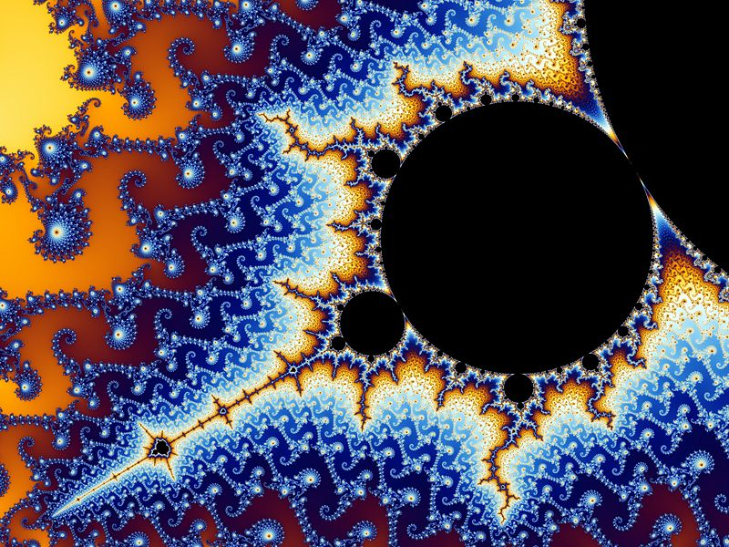

When we say something is **complex** we mean to suggest that it is the
inevitable result of combining its elements, and that this implies no
fault or failure, as when we say "a recipe is complex".

**Complicated**, on the other hand, is what we call something that is
very hard to understand, solve or explain, for example "a complicated
court case".


Look at this image:



This is undoubtedly a complex image. In case you don't know it, this is
the famous [Mandelbrot
set](http://es.wikipedia.org/wiki/Conjunto_de_Mandelbrot), a fractal, a
geometric figure with the peculiar property of self-similarity: if we
zoomed in on some parts of the image we would get images as beautiful
and complex as this one. You can check what I'm saying by watching [this
video on youtube](http://www.youtube.com/watch?v=gEw8xpb1aRA), which
explores the Mandelbrot set.

It is clearly a rather complex image, with infinite detail.

And yet mathematicians tell us that the information contained in the
image above is essentially zero.

The Mandelbrot set, which produces the image above and the video I
pointed you to, can be expressed in fewer than 140 characters (in a
tweet of 48 characters):

*M*= C**{z: | (z+(z+(z+(\...+(z+z**2**)**2**\...)**2**)**2**)**2**)**2 \> 2}


That is a complicated expression for someone who doesn't know much
mathematics. But it isn't very complex. In fact, a program that computes
the Mandelbrot set takes no more than about 50 lines of code (depending
on the language)[^*].

The original image above is 800 x 600 pixels, and each pixel has 24 bits
of information, so if we stored the image in a file it would take
11,520,000 bits. Yet the program, written in C, that describes that
image could take about 64,000 bits.

The Russian mathematician Kolmogorov invented the concept of Descriptive
Complexity, or Algorithmic Entropy, to try to measure the computational
resources needed to describe an object.

For example, consider these two strings of letters ([taken from
wikipedia](http://en.wikipedia.org/wiki/Kolmogorov_complexity#Chaitin.27s_incompleteness_theorem)):

```
    abababababababababababababababababababababababababababababababab

    4c1j5b2p0cv4w1x8rx2y39umgw5q85s7uraqbjfdppa0q7nieieqe9noc4cvafzf
```

Both have the same length, 64 characters. However, the first string can
be expressed as "ab 32 times", in just 11 characters. For the second
string there seems to be no shorter way than writing it out directly.

Kolmogorov would say the first string is less complex than the second.

Now, back to the Mandelbrot set. It turns out that the program that
computes the points of the set has a parameter, which sets the number of
iterations needed to determine the next pixel to draw. And if we choose
to draw a more detailed segment of the Mandelbrot set, that is, to zoom
in, this parameter has to be larger, which means the computer spends
more time and resources to generate the detail of a deeper part of the
set. Clearly, the definition of algorithmic complexity, taken as the
length of the program, doesn't seem to adequately reflect the actual CPU
usage in this problem.

The question is whether this definition of complexity is adequate.
Because according to Kolmogorov's notion the Mandelbrot set is not a
complex thing, and we have already seen that in terms of computational
cost (energy and processing time) it doesn't look simple.

On the other hand, a random object such as the string
"4c1j5b2p0cv4w1x8rx2y39umgw5q85s7uraqbjfdppa0q7nieieqe9noc4cvafzf" has a
very high (or maximal) Kolmogorov complexity, but it is not a very
interesting thing to study.

A television showing nothing but static isn't very interesting. In the
end it is just plain noise, but that random noise is complex in
information terms, if we follow Kolmogorov's idea.

This notion of complexity is not satisfactory, and a lot of research
effort goes into finding a mathematical definition of complexity that
captures our intuitive notions of it.

I want to invite you to explore the study of complexity, something that,
as we will see in the coming articles, has been a rather complicated
task. :)

Notes:

[^*]: to complicate things, the z in the expression are complex numbers
(I couldn't help it, sorry ;)
