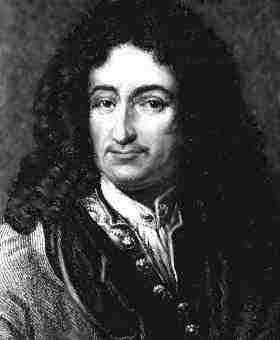

> *Sans les mathématiques on ne pénètre point au fond de la philosophie.
Sans la philosophie on ne pénètre point au fond des mathématiques.\
Sans les deux on ne pénètre au fond de rien.*\
> -- Leibniz

(Without mathematics we cannot get to the bottom of philosophy. Without
philosophy we cannot get to the bottom of mathematics. Without both we
cannot get to the bottom of anything.)

Guided by the mathematician [Gregory Chaitin](http://es.wikipedia.org/wiki/Gregory_Chaitin), we will
venture into the ideas on complexity of the great philosopher and
mathematician
[Gottfried Leibniz](https://es.wikipedia.org/wiki/Gottfried_Leibniz). This
article is based on Chaitin's talk titled "[Leibniz, Complexity and Incompleteness](http://www.cs.auckland.ac.nz/~chaitin/apa.html)".

The first consideration of complexity that Chaitin finds in Leibniz is
in the "Discourse on Metaphysics", where he considers the "experimental
data" given by ink spots on a piece of paper, obtained by shaking a quill
pen over it. Take the finite set of points obtained this way, and ask
whether it obeys a *natural law*. Well, for Leibniz it is not enough
that there is a mathematical equation passing through all the points,
because there always is such an equation. The set of points obeys a law
only if there is a simple equation that passes through all of them.

The second example of the philosopher's concern with complexity is when
he asks "why is there something rather than nothing, if nothing is
simpler than something?", in 1714, in his "Principles of Nature and
Grace." In modern terms, what the rationalist philosopher wants to know
is where the complexity we observe in the world comes from. For Leibniz
the answer is God. God has created the best possible world, and all the
richness and diversity we observe in the universe is the product of a
simple, beautiful and elegant set of ideas. God maximizes the richness
of the world while **minimizing the complexity of the laws that
determine it**. In modern scientific terms, the world is understandable,
comprehensible, and science is possible, because there is a law that can
be understood.

The cosmologist [Max Tegmark](https://en.wikipedia.org/wiki/Max_Tegmark)
argues that it is simpler to consider an ensemble of all possible laws
and all possible universes than to consider one particular universe. In
other words, the multiverse is more fundamental than the question of the
laws of our particular universe. To illustrate the idea, the set of all
positive integers 1,2,3,\... is very simple, even though a particular
positive integer, such as 12478329212991232, can be arbitrarily complex.

I want you to think this idea through: it is simpler to think about the
multiverse than to try to justify the complexity of our universe. All
possible universes exist, and ours has nothing special about it when
seen from that perspective. It looks complex, and special, simply
because we live in it.

In the [Monadology](https://www.helicon.es/dig/8542205.pdf) Leibniz
discusses the means of carrying out a mathematical proof. There he notes
that to prove a complicated statement you break it down into simpler
statements, until you reach propositions so simple that they are
self-evident and need no proof.

Epistemologists have analyzed Leibniz's ideas, and have observed that
this crucial idea of complexity in Leibniz is something very hard to pin
down. How do we measure the complexity of an equation, and therefore the
complexity of natural laws?

If we propose the length of the equation as a measure, that is something
that changes over time. Besides, what are the basic elements an equation
is allowed to have? Do Bessel functions count as part of the standard
notation?

If nature is to be governed by simple laws, as Leibniz demands, we need
to know how to measure the simplicity of those laws. Well, Chaitin has a
proposal, but we will talk about that in the next article.
