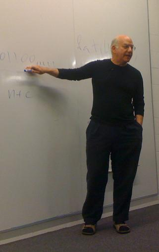
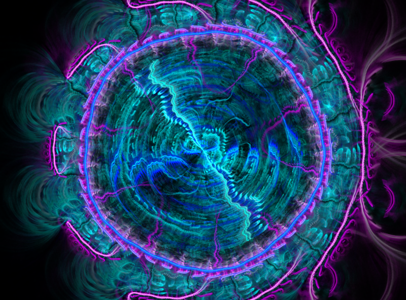

As [we saw](/en/blog/lnds/2010/06/03/leibniz-and-the-simplicity-of-the-laws-of-nature/),
Leibniz argues that nature must obey simple, beautiful and elegant laws,
that is, comprehensible laws; otherwise science is not possible. The
philosophical problem is knowing what we mean by simple laws. The
simplicity of the equations that describe them? And what about all the
prior knowledge you need in order to understand those equations?

Gregory Chaitin proposes an answer from the point of view of
[Algorithmic Information Theory](http://es.wikipedia.org/wiki/Teor%C3%ADa_algor%C3%ADtmica_de_la_informaci%C3%B3n) (AIT).

In the 1960s three mathematicians, Solomonoff, Kolmogorov and Chaitin,
proposed this theory (Chaitin was a teenager when he formulated these
ideas).

For Chaitin, AIT gives a precise answer to the definition of law that
philosophers of science demand. The answer comes from changing the
context. Instead of taking the experimental data to be points and
requiring the laws to be equations, in AIT everything goes digital,
everything becomes combinations of 0s and 1s. For AIT a law of nature is
a piece of software, a computer algorithm, and instead of trying to
measure the complexity of the law by the size of the equations, we
consider the size of the programs, the number of bits in the software
that implements our theory.

This is expressed in the following diagram:

**Law:** Equation → Software,

**Complexity:** Size of the equations → Size of the program, Bits of
software.

For Algorithmic Information Theory, scientific work is modeled like
this:

Theory (01100\...11) → **COMPUTER** → Experimental Data (110\...0).

In this model, both the theory and the data are finite strings of bits.
A theory is software for explaining the data, and that means the
software produces or computes the data exactly, without errors. In other
words, in this model a scientific theory is a program whose output is
the data: self-contained software, with no input at all.

Compare this with Leibniz's observation that you could always come up
with a complicated equation for any arbitrary set of data. In this model
there is always a theory with the same number of bits as the data it
explains, because the software can always contain the data it is trying
to compute as a constant, avoiding any computation. In that case there
is no law; it is not a real theory. In this model we say the data
follows a law, can be understood, only if the program that computes it
is smaller than the data it explains.

In Chaitin's words: **"understanding is compression, comprehension is
compression, a scientific theory unifies many seemingly disparate
phenomena and shows that they reflect a common underlying mechanism".**

If the world we observe, the complexity we observe, is a product of the
laws of nature, and those laws are software, then everything is a
product of software. I like that idea a lot. What can I say? I think I
picked the ideal career! :)

Well, if this is so, then the best theory is the one with the shortest
program that produces, precisely, the observed data. This would be the
version, in terms of algorithmic information theory, of [Occam's
razor](https://es.wikipedia.org/wiki/Navaja_de_Ockham). With these
notions you can define complexity in mathematical terms, and start
proving things about the laws of nature.

The first thing you notice is that most finite strings of bits have no
laws: they are algorithmically irreducible, random in the algorithmic
sense, because there is no theory substantially smaller than the data
itself. That is, the smallest program that produces the output is the
same size as the output.

The second thing you notice is that you can never be sure you have found
the best theory. To understand this last point we need to get better
acquainted with one of the great achievements of logical thought, and we
will leave that for a future article. I think these ideas give you
plenty to chew on.

One last thing. I think I have said this more than once: learning to
program is easier than learning mathematics, and by programming
[we can learn mathematics much better](/blog/2009/02/un-programa-para-ensenar-matematicas.html),
and perhaps more deeply, so Chaitin's path opens the door to
understanding the laws of nature through programming.

Around minute 4 of [this
video](http://www.vivamerica.com/madrid/programacion/innovacion/atomos-versus-bits/ricardo-galli-las-seducciones-de-la-informatica),
[Ricardo Galli
says](http://gallir.wordpress.com/2009/10/13/anotaciones-cientificas-de-seducciones-de-la-informatica/)
that the code of an audio compressor sums up everything we know about
human hearing, and he is quite right. In that code the physics of sound
and the biology of our ear are joined together.

Computing is not just a natural science; it is a fundamental science.

(\*) The image is an electric sheep and was taken from
[here](https://v2d7c.sheepserver.net/cgi/dead.cgi?id=1371).
