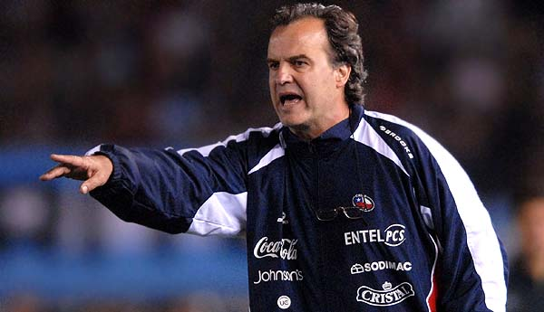

Today everyone is celebrating Chile's win over Honduras, you can hear
Chilean vuvuzelas in the streets, and the joy is justified. We're
happy, and good for us, it's nice to see so many cheerful people in the
streets, on the subway, and especially at work.

Bielsa's trick is no trick at all. It's simply doing his job well and
demanding from his players the same thing he does: acting like a
professional.

