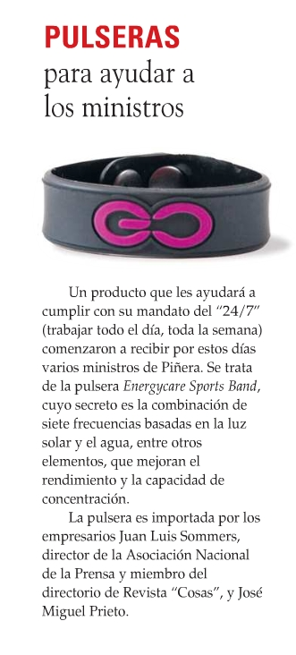

 
> A couple of years ago we were complaining about [a minister's digital
> illiteracy](/en/blog/lnds/2008/05/11/the-ministers-digital-illiteracy/).
> Now it seems we are facing something worse. I read this gem on [Luis
> Ramirez's blog](http://luisramirez.cl/blog/?p=3109):

Doesn't it worry you that our authorities fall for this kind of
ignorance?

And before anyone comes at me with the pseudoscientific explanation of
the properties of the 7 frequencies in the hologram of the famous little
bracelet, allow me to transcribe this explanation, taken from
[this post](http://cnho.wordpress.com/2009/11/16/pulseras-power-balance-mas-charlataneria-pseudocientifica/)
on the pseudoscientific foundations of this magic gadget:

> Do these Power Balance gentlemen know what the hell a frequency is?
> According to them, it seems a "frequency" is some kind of beneficial
> emission, something like an "energy", only more modern. Something
> that can also be "embedded" in a hologram, no less\...
>
> Well, no. A "frequency" is not some ultra-technological emission.
> Frequency is simply a physical quantity that indicates the rate at
> which a phenomenon repeats per unit of time. So we can say that the
> heart rate of a healthy human is 60 to 80 beats per minute, that
> meteorites one meter in diameter hit the Earth with a frequency of one
> per year, or that a vehicle's engine turns at 4,000 revolutions per
> minute.
>
> The general formula for calculating the frequency of an event consists
> of measuring the time between two repetitions and taking its inverse:

> So if an event repeats every 0.5 seconds, its frequency
> will be 1/0.5 = 2 cycles per second.
>
> \...
>
> In the case of waves (such as waves in water, in air, or
> electromagnetic radiation), the frequency is the number of
> oscillations (complete vibrations) that any particle of the disturbed
> medium through which the wave travels performs in one second. A
> fast vibration corresponds to a high frequency, while
> a slow vibration corresponds to a low frequency.

> So what does "embedding a frequency" mean? Obviously, it is
> completely incorrect, not to say utter nonsense, equivalent to
> "embedding a length" or "embedding a volume". When we say that
> something "emits a frequency", what is actually emitted is radiation,
> a sound or a vibration of some kind, which will have certain
> characteristics: an amplitude, a wavelength and a **frequency**.
>
> That is why you cannot emit or record frequencies "on their own",
> just as you cannot emit or record lengths or volumes
> "on their own".

Kids, learn science, so they can't fool you with all this
quackery!

The truth is that these bracelets and the people who sell them should be
reported to the authorities for fraud\... no wait!
