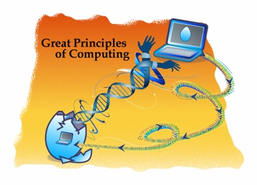

 

**What is information?**

**What is computation?**

**What can we know through computing?**

**What can we not know?**

> These questions were once of interest only to computing specialists,
> but they are now the concern of people in every field of science,
> engineering and even politics
> ([except in
> Chile](http://www.alejandrobarros.com/content/view/849049/La-modernizacion-del-Estado-sigue-con-una-pata-coja.html#content-top),
> of course).

> Computing is the science of information processes. Information
> processes have been discovered in the deep structures of
> all these fields.

> Unlocking the mysteries of these processes will make great advances
> possible in these fields. The principles of computing are
> helping with this task.

> Computing needs a new language for its basic principles.
> The traditional way of framing the ideas, around computing
> technologies, puts the computer, rather than computation, at the
> center. The computer is the tool, computation is the principle.

> The [Great Principles of
> Computing](http://cs.gmu.edu/cne/pjd/GP/GP-site/welcome.html) project
> is developing a language for discussing the fundamental principles
> of computing. This framework is helping foster
> collaboration between computing and other fields. It is helping
> innovation by exposing previously unseen connections among
> technologies. It is helping communicate the joy, the pleasure of
> computing to young people, who can now see how these
> principles serve them in their daily lives, even when they are
> disconnected from their computers.

The text above comes from the [Great Principles of Computing](http://cs.gmu.edu/cne/pjd/GP/GP-site/welcome.html) site, an initiative led by Peter Denning.

Peter Denning, Image via
[Wikipedia](http://commons.wikipedia.org/wiki/File:PJD.jpg)

When we understand the principles of computing we stop getting tangled
up in mistaken terminology, and the concepts become clear (why we say IT
and not ICT, for example). We understand why it matters to grasp the
power of computing, and why it is a
[fundamental science](/en/blog/lnds/2012/05/18/everything-is-software/).

Denning and his team have developed a conceptual framework, after
analyzing a number of computing technologies to identify the principles
they are based on, and studying how aspects of computing are influencing
other fields. From this analysis they concluded that the principles of
computing can be grouped into seven categories:

> **Computation** (meaning and limits of computation)
>
> **Communication** (reliable data transmission)
>
> **Coordination** (cooperation among networked entities)
>
> **Recollection** (storage and retrieval of information)
>
> **Automation** (meaning and limits of automation)
>
> **Evaluation** (performance prediction and capacity
> planning)
>
> **Design** (building reliable software systems)

These categories are the result of a functional analysis of many
computing technologies and applications.

> 1.  Computing systems are built from "processing elements"
>     that process and store information (computation,
>     recollection).
> 2.  Processing elements exchange information
>     (communication).
> 3.  Processing elements cooperate toward a common goal
>     (coordination).
> 4.  Humans delegate tasks to systems of processing
>     elements (automation).
> 5.  Humans predict the speed and capacity of systems
>     (evaluation) and
> 6.  Humans decompose systems into processing elements
>     and organize their construction (design).

These categories are windows for looking into the knowledge space of
computing, rather than zones or partitions. Each window sees the space
in a distinctive way, but the same thing can be seen through more than
one window. For example, internet proto\
cols are sometimes seen as data communication, sometimes
as coordination mechanisms and sometimes as means of
recollection.

When I took the modern physics course in engineering school, I was told
a story. It began with Planck's attempt to explain black-body radiation
with a better model, one compatible with what was observed and that did
not lead to the absurdities predicted by the classical model, and it
continued with Einstein's work and the confirmation that energy quanta
exist.

Science explains its principles this way, through stories, where a
narrative tells how the principle evolved and gained wider acceptance
over time. The main contributors to the ideas are named. The early
mistakes are explained, and finally how these principles work, and how
they affect everything else. In computing, stories that narrate the
principles of our science are relatively rare.

Sadly, in the training of computing engineers, these narratives of the
principles, of how the main ideas of our field evolved, are absent. I
have met computing engineers who have no idea who Alan Turing, Knuth,
Parnas, or Denning himself were, or what principles they contributed to
the field.

Those are the narratives we must collect and spread, among the
specialists, among the young people we want to train, and among those
who are not specialists but are affected by our work. That is another
mission of this blog: to spread these narratives, and these principles
of computing.
