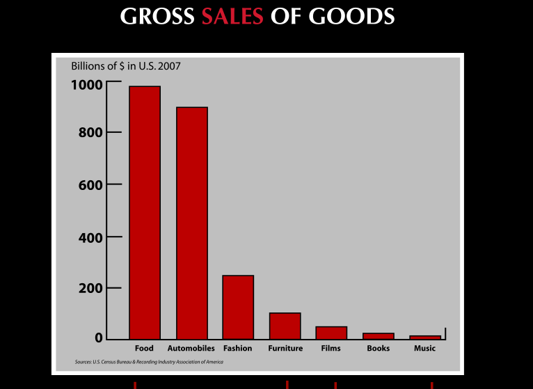

 
The chart below shows 2007 sales, in billions of dollars, for several
industries. The main difference among them is the degree of intellectual
property protection. On the left are the ones with very low, or almost
no, intellectual property protection, and on the right the industries
with a high degree of intellectual property protection:

The chart is part of the talk Johanna Blakley gave at
[TEDxUSC](http://stevens.usc.edu/TEDxUSC) this year.

The [talk is brilliant](http://www.ted.com/talks/lang/spa/johanna_blakley_lessons_from_fashion_s_free_culture.html),
and when it gets to this chart it draws applause. After all, fashion
is built on [imitation](http://www.valevenegas.com/2010/07/un-poco-largo-lo-se.html),
a point that [La Valentina](http://www.valevenegas.com/) complements very well (synchronicity again; the emphasis is mine):

> [...] imitation becomes a key instrument of social
> navigation. Imitating the other necessarily implies, first, a
> recognition of their distinguishing signals and then an
> identification with them, becoming the first step in the
> creation of community, which is fully formed when people
> make those signals their own and consolidate them as a shared code,
> or reject them, establishing the difference. **It is imitation that
> gives us the assurance that we are not mistaken**, that we have
> not wrongly strayed outside the margins drawn by the group
> we belong to, or that we are not drifting even further from the group
> of people we want to be associated with. Imitation is therefore
> the safest way to feel part of something, and therefore
> to feel special and distinguished compared with those who have not yet
> achieved that special status. It is also from here that
> we seek difference, whatever makes us not like those people, but which
> inevitably seeks to find its meaning in others, other others.\
> **source**: <http://www.valevenegas.com/2010/07/un-poco-largo-lo-se.html>

Imitation is the starting point for innovation. I think these lessons
are important, and we should reflect on them. It is gratifying
to hear them.

Here is the video:



Subtitles are available: [http://www.ted.com/talks/lang/spa/johanna*blakley*lessons*from*fashion*s*free\_culture.html](http://www.ted.com/talks/lang/spa/johanna_blakley_lessons_from_fashion_s_free_culture.html)
