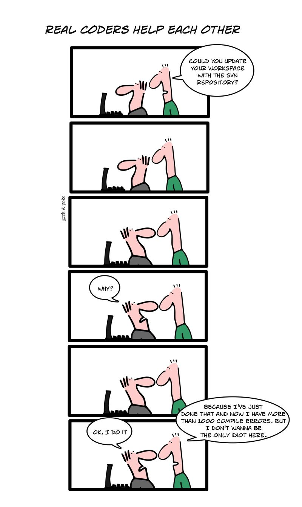

My previous note on version control was well received, and I got
comments from people who are not software developers, which is
good. I insist that version control is a tool with
applications outside the programming world.

But last time we talked about centralized systems, like
[Subversion](https://subversion.apache.org/) (SVN) or
[CVS](https://www.nongnu.org/cvs), the most popular ones. This time I
want to invite you to try distributed version control systems, or
DVCS.

If your mind has not been damaged by systems like Subversion or CVS,
you will have no trouble adopting these systems, and I suggest you
explore the two most popular ones today,
[Mercurial](http://mercurial.selenic.com/) (hg) and
[Git](http://git-scm.com/).<http://git-scm.com/>.

When you first face a DVCS coming from the world of
centralized systems, the model is hard to adopt. You have to
relearn a few things.

I suggest reading this tutorial by Joel Spolsky, where he explains very
well the changes we have to make when we move from a centralized system
like Subversion to a DVCS, Mercurial in his case.

The main thing is the freedom we gain as developers.

Subversion keeps us from getting the benefits of version control because
it always forces us to commit only when the code is fully
tested and bug-free, or else we are wrecking
everyone else's work.

This Geek and Poke cartoon lays out the problem:

With a DVCS programmers work on their own private copies of the
repository without interfering with the central code.

DVCSs have very good mechanisms for merging
code that comes from different branches.

Git is an outstanding example here, since
[Linus Torvalds](http://torvalds-family.blogspot.com/) himself is able to
merge from 12 different branches with almost no trouble.

I have evaluated 4 tools, using each of them for quite a while in my
personal work.

The first tool I used was Bazaar, about 3 years ago. Bzr is
the tool used by Canonical in the development of Ubuntu. It is
written in [Python](http://www.python.org/), and it is quite simple
to use.

The second was [Darcs](http://darcs.net/), an interesting tool,
developed by a quantum physicist, which has a mathematical
model ([algebra of patches](http://darcs.net/manual/node9.html#Patch)) and is written in
Haskell. Recommended for those with more academic inclinations.

The third and fourth are Mercurial and Git.

As someone out there put it, [Git is MacGyver, Mercurial is James Bond](https://importantshock.wordpress.com/2008/08/07/git-vs-mercurial/).
Both have their pros and cons.

I like Git, and it is what I currently use personally.
Bringing the change to the corporate environment where I work will take
time, I think, but I can keep interoperating with Subversion thanks to Git.

What I like most about Git is that it is a very fast tool. It is
probably the fastest version control system I have used,
even when I push to a central server on the internet.

But the decision is yours. If you have never used Subversion or CVS, you
are better off choosing a DVCS. If you ask me, I recommend
Git, or Mercurial. The latter is probably simpler to use, but the
former is more flexible and faster.

