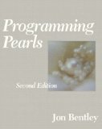
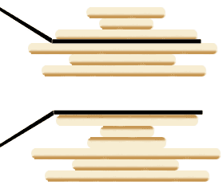

The [sorting problem](https://es.wikipedia.org/wiki/Algoritmo_de_ordenamiento) is one
of the basic topics in every programmer's training. But perhaps
this well-known problem holds the key to understanding how the
evolution of life works. How? That is a story involving none other
than Bill Gates, but before telling it let's review this classic
computing problem.

How do we sort a series of data? It is such a basic task that we
almost take it for granted. It even comes built into our languages and
operating systems, or as a standard function in every
spreadsheet program.

One exercise that has become popular is: what is the most
efficient way to sort a million 32-bit integers? It is even used as
a hiring test. The answer of course depends on many
assumptions. At least [Barack Obama knows that bubble sort is not the best
algorithm](/en/blog/lnds/2007/07/22/obama-knows-computer-science/),
but is an "efficient" algorithm, like quicksort or heapsort, the
best way to solve this problem?

How do you measure the efficiency of an algorithm? By the time it takes
to run, or by the memory it uses? That is why there are variants of this
problem, like a fairly popular one that goes: how do you sort a million
32-bit integers in 2 megabytes of memory? A trick question, because
a million 32-bit integers take up 4 megabytes. Believe it or not,
even the greats struggle with this question, like the great Guido
van Rossum (creator of Python), as you can see
[in this article](http://neopythonic.blogspot.com/2008/10/sorting-million-32-bit-integers-in-2mb.html).

Another classic form of this problem appears in the first chapter of
 that wonderful book every developer should have in their
library: [Programming Pearls (2nd Edition)](https://www.amazon.com/gp/product/0201657880?ie=UTF8&tag=lanaturaledel-20&linkCode=as2&camp=1789&creative=9325&creativeASIN=0201657880),
written by Jon Bentley. Fortunately Bentley's column is
[available online](http://www.cs.bell-labs.com/cm/cs/pearls/cto.html), and I recommend
reading it (but buy the book and keep it under your pillow).

Bentley's problem is to sort a file of numbers in the range
0 to 999,999, with only 1 megabyte of memory. The interesting thing about
Bentley's column is that it teaches the importance of pinning down the
specification in order to reach a suitable solution. In Bentley's
case he not only gets a solution that works in a small amount
of memory, he also gets an efficient O(n) algorithm, using
a very efficient data structure.

But let's get to the surprising story about sorting, which involves
a millionaire and some pancakes.

## **Bill Gates sorts pancakes**

What many of you may not know is that Bill Gates made a
scientific contribution to the sorting problem by writing a paper
(the only known mathematical article that bears his name) describing
the obscure [pancake sorting](http://en.wikipedia.org/wiki/Pancake_sorting) algorithm. If you don't believe me,
[here is the link to the paper](http://www.cs.berkeley.edu/~christos/papers/Bounds%20For%20Sorting%20By%20Prefix%20Reversal.pdf),
published in Discrete Mathematics in 1979.

The idea is to sort a stack of pancakes by size, using
a spatula. The only operations allowed are inserting the spatula
and flipping the pancakes.

To give you an idea of the operation, this is the drawing that
accompanies the explanation of the algorithm on Wikipedia:

At the top we see how the spatula has been inserted in the middle, and
then it is turned, flipping the first three pancakes.

The problem is to find the algorithm that sorts the
pancakes, leaving the largest at the bottom and the smallest on top, using
the fewest operations (flips of the spatula).

The interesting part is that a variation of this algorithm, known as the
burnt pancake problem (**Burnt Pancake Problem)**, was
developed by one of the creators of Futurama, David X. Cohen, and was
implemented in 2008 with a "computer" made of E. coli
bacteria that flipped segments of DNA. The problem was solved
when the bacteria developed resistance to antibiotics (?).

The truth is that it's complicated, but [here is another
link](http://plus.maths.org/issue54/features/colvatter/) for when
you decide to look into bioinformatics and play with bacteria that
shuffle segments of DNA.

What matters is that DNA evolves through small mutations.
In trying to understand these mutations, biologists found that
this obscure mathematical problem can shed light on the way
life evolves through mutation.

Who knows, maybe one day Bill Gates will go down in history not as the
aggressive super businessman, but as the accidental discoverer of a
fundamental mechanism for understanding how life works.

