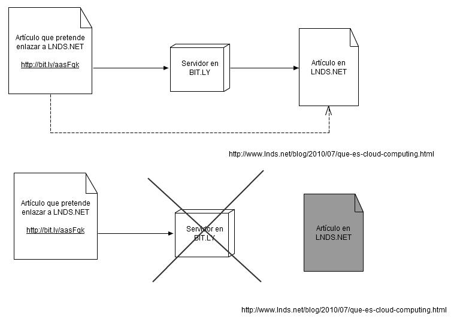

> "All those... moments will be lost in time like tears in rain." -- Roy Batty, Blade Runner

Recently an article of mine was linked to, but not directly. Instead
it was done with a link generated by bit.ly, a "URL
shortener". I have talked before about the [problem with these
services](/en/blog/lnds/2010/07/31/the-problem-with-tinyurl-recycled/)(\*).
Now, thinking it over, I have realized that these URL shorteners
are introducing a *bibliographic problem*, and not a minor one.

It is natural to use URL shorteners on Twitter given the
140-character limit per message. That is perfectly fine in that
context, but it is inappropriate to use a short link in a blog
article. Twitter is a real-time service, designed to hold
ephemeral conversations, but a blog post or article is something that
lasts much longer, and so the right thing to do is to put the direct,
complete link in these texts, not the intermediate result
provided by bit.ly, tinyurl or some similar service.

The following diagram illustrates the problem:

If tomorrow bit.ly disappears as a service, or through some error
that link gets lost in its databases, the link
between the two articles is lost.

Consider that the PageRank algorithm uses links between pages as
one of the fundamental elements for deciding the popularity of a
page. By using URL shorteners we are affecting that index, which
is a loss for whoever is being referenced (LNDS in this
case), but it is also a problem for whoever does the referencing,
because they end up isolated from the rest of the web. I don't know how
search engines are handling these short links, but I suspect they give
them less weight.

What this use of URL shorteners on blogs and wikis does is damage the
"bibliographic" quality of our links. It makes them depend on a
third party, on a service that can perfectly well disappear when the
venture capital keeping it running dries up. If we want to write
serious, valuable articles, we must not use short URLs for our
links.

What is going to happen is that, to paraphrase Roy Batty, *"All those...
**links** will be lost in time like tears in rain."*

(\*) in that [article](/en/blog/lnds/2010/07/31/the-problem-with-tinyurl-recycled/)
I mention dev.cl, which was popular among Chilean Twitter users and
no longer offers this service. Those links were lost.
