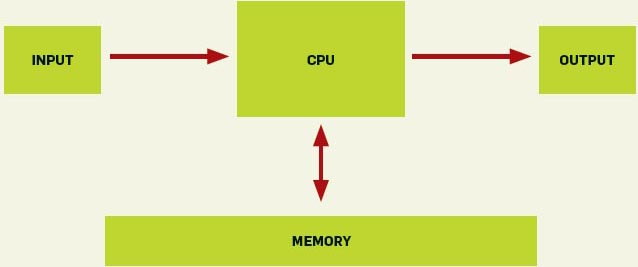

The following diagram is the model of a computer taught to every
student of computer engineering or computer science:

]

The problem is that this model was fine some 40 years ago, but
it has nothing to do with modern computer architectures.

In an [interesting
analysis](http://cacm.acm.org/magazines/2010/7/95061-youre-doing-it-wrong/fulltext)
Poul-Henning Kamp shows how an algorithm that has been considered
efficient for 47 years, and has even been analyzed by great
luminaries like Donald Knuth, can be optimized by an order of
magnitude if you take into account the effects of the architecture it
runs on.

Consider this: 30 or 40 years ago, when a virtual memory
access caused a "[page fault](http://en.wikipedia.org/wiki/Page_fault)", a disk access was required, which took about 2 milliseconds. Back then a CPU executed
an instruction in 2 microseconds, so in the 2 milliseconds
the disk access took, 1,000 instructions were lost.

On a modern computer, where clock frequency is measured in GHz,
the worst case means losing 10 million instructions on
a page fault (assuming solid-state disks, SSDs; with a regular
disk the number is close to 100 million).

> *What good is an O(log2(n)) algorithm if those operations
> cause page faults and slow disk operations? For many
> datasets an O(n) or even an O(n^2) algorithm that avoids
> page faults would run much faster.*

> *Performance analysis of algorithms will always be a cornerstone
achievement of computer science. But the
results coming out of the computer science department
would be more interesting and useful if they applied to real computers,
and not toy ones.*
>
> -- Poul-Henning Kamp [You're doing it wrong](http://cacm.acm.org/magazines/2010/7/95061-youre-doing-it-wrong/fulltext).\_
