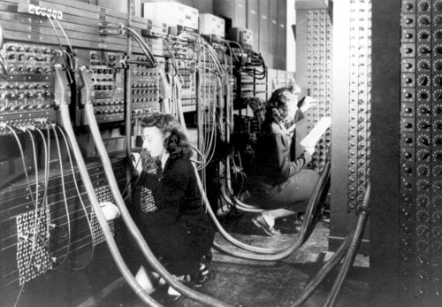
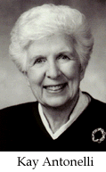
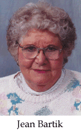
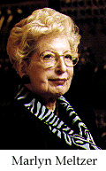
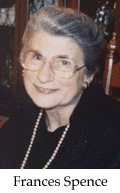

The photograph shows two of the six original women programmers of the
[ENIAC](https://en.wikipedia.org/wiki/ENIAC), the first general-purpose
electronic computer:

The six original ENIAC programmers were: [Kay
Antonelli](http://en.wikipedia.org/wiki/Kathleen_Antonelli), [Jean
Bartik](http://en.wikipedia.org/wiki/Jean_Bartik), [Betty
Holberton](http://en.wikipedia.org/wiki/Betty_Holberton), [Marlyn
Meltzer](http://en.wikipedia.org/wiki/Marlyn_Meltzer), [Frances
Spence](http://en.wikipedia.org/wiki/Frances_Spence) and [Ruth
Teitelbaum](http://en.wikipedia.org/wiki/Ruth_Teitelbaum).

The ENIAC was developed during World War II to
help with ballistics calculations, although its main use was in
computing the parameters for the first hydrogen bomb. Construction
began in 1943, it was formally accepted by the U.S.
Army in July 1946, and it ran continuously until 11:45
pm on October 2, 1955.

And although its inventors, [John Mauchly](https://en.wikipedia.org/wiki/John_Mauchly) and
[J. Presper Eckert](http://en.wikipedia.org/wiki/J._Presper_Eckert), became
famous, the story of this machine's first 6 programmers was not
known until many years later. It began to come to light in
the second half of the 1980s, thanks to the research
of Kathy Kleiman. In 1997 these six women were
inducted into the hall of fame of [WITI](http://www.witi.com/) (Women
In Technology International).

If you want to know more you can visit Kathy Kleiman's site
<https://www.eniacprogrammers.org/>


