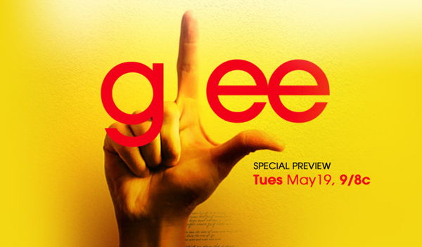

Thanks to [Rock Band](/en/blog/lnds/2010/08/08/fake-plastic-rock/) and
[Glee](http://es.wikipedia.org/wiki/Glee_(serie_de_televisi%C3%B3n)), I can
say that when it comes to musical taste, my kids and I have quite a lot
in common, with one big exception: I never could stomach Madonna. But
on Journey, there are no two opinions in my family.

Glee is a pretty entertaining TV series, popular with young people,
where the heroes are the kids of the Glee Club, a bunch of losers, hence
the L on the forehead, who have the guts to sing and make it as a choir.

Along the way the show takes on issues like teen pregnancy and alcohol
abuse. But there is one issue Glee dodges: copyright, as
[Christina Mulligan points out](http://balkin.blogspot.com/2010/06/copyright-elephant-in-middle-of-glee.html).

In one episode of Glee the club sets out to make a copy of Madonna's
Vogue video(\*). The problem is that the penalty for doing that is
150,000 dollars. Mulligan keeps the examples coming: in another episode
a character (Sue) posts her own version of Olivia Newton-John's Physical
on the internet. If that happened in the real world, Sue would have to
pay 300,000 dollars in damages to the American recording industry. For
every mashup the Glee characters put together, they should be paying
150,000 dollars a pop.

But the show doesn't show any of that. Glee teaches that remixing or
covering famous songs is a good and legitimate thing to do, and that
nobody is going to give you any trouble over it.

You may think I'm exaggerating, but in the United States teenagers do
get pursued for doing exactly what they see on Glee. For example, the
American Society of Composers, Authors and Publishers (ASCAP) asked the
American camping association, Girl Scouts included, [to pay royalties in
order to sing copyrighted songs at their camps](http://www.nytimes.com/1996/12/17/nyregion/ascap-asks-royalties-from-girl-scouts-and-regrets-it.html?pagewanted=all)!

It is routine for copyright holders to take down YouTube videos that
show teenagers dancing to pop songs.

There is a tension, and a contradiction, in this series that has nothing
to do with the series itself. The problem, as Doctorow says in his
comment on Mulligan's article, is that the industry sends a
contradictory message: "[do as I say, not as I
do](https://boingboing.net/2010/06/09/glee-vs-copyright-do.html)".
On one hand, the very same people who produce this show, which promotes
fair use and remixing, accuse those who copy of being thieves.

It's almost as if they were telling us: "kids, watch on TV how lovely
it is to mash up, cover and copy songs, because you can't do it
yourselves, losers!"

(\*) the [link to this video](http://www.youtube.com/watch?v=GuJQSAiODqI), provided by
Christina Mulligan, can't be viewed in Chile, due to copyright
protection.
