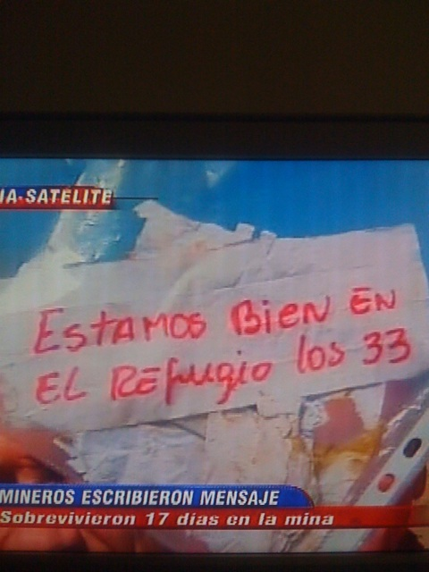

 
> "We are fine in the shelter, the 33 of us"

33 miners have survived for 17 days more than 680 meters underground.
That message, so simple, tied to the end of a probe, has been one of
the most joyful pieces of news I have ever witnessed, as far as I can
remember.

Good for the *viejos*, the "old men", as miners are known here. [I was
born in mining country](/en/blog/lnds/2007/08/02/goodbye-chuquicamata/); my old
man, though he wasn't a miner, sometimes had to go into the mine at
Chuqui too. I'm thinking of him right now, and of so many other
"viejos" I have known.

It is moving, it gives hope, a beautiful and unforgettable moment.
