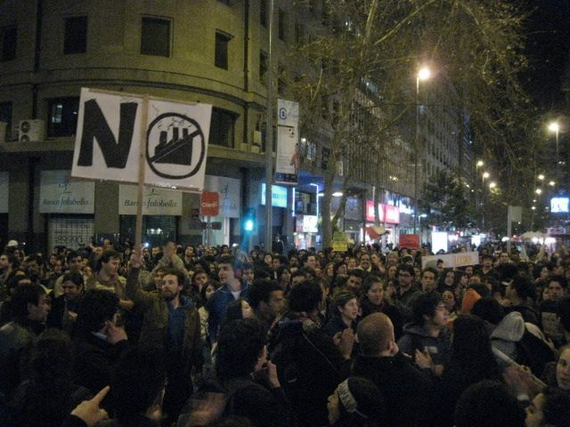

This image is wonderful:

because it refutes a [post I
published](/en/blog/lnds/2010/08/24/digital-inactivism/)
the very day this photo was taken: people can go from clicktivism to
real activism. Social networks can be used to mobilize people to
protest and demonstrate peacefully when they disagree with something.
My regards to those who demonstrated; you shut me up. I take my hat
off. When someone is convinced that something is wrong, and acts to
change it, I find that brave and noble.

All good, but today the environmentalists let me down, because they
are calling for a protest by blackout.

Come on! You were doing so well!

This is nothing new. There is a worldwide movement called \"Earth
Hour\", which consists precisely of making that sort of \"gesture\":
turning off the lights for an hour. In this case, they are calling for
lights off for 5 minutes, to protest the building of a coal-fired
power plant at Punta de Choros.

More than a few people will have thought the gesture matters, because
the needles at the power plants must have dipped, and that must have
worried the evil executives of these companies, but the truth is, no.
These blackouts do nothing to the power generation companies, or to the
authorities, because, let's be honest, they barely register. They are
harmless protests, a small extension of the tweet. A march gets
noticed; 1,000 houses switching off their lights does not.

**The energy paradox**

Energy is not something in danger of extinction. Nor is it a scarce
resource. Energy is neither created nor destroyed, only transformed.
Electrical energy has to be generated; if you don't use it, someone
else uses it in your place, and if nobody uses it, it is lost and
dissipates (guess what, it turns into heat that goes into the
atmosphere, and on we go warming the planet).

The truth is that it suits the power generation companies to know about
these blackouts (when they really are massive), because they sell that
surplus energy to others (and it's a good thing somebody buys it,
because otherwise it dissipates as heat, and global warming is a bad
thing, remember that).

These energy sales are being automated more and more, so I imagine that
in the future they will be able to monitor these calls for a blackout,
watching the social networks, anticipate a drop in demand and offer it
to the market, almost in real time.

So there you have it, kids, the paradox. When you decide to stage a
blackout in protest, these are the things that happen: the companies
sell the surplus to others (so you don't even tickle them), and the
energy that isn't used dissipates, with which you contribute to global
warming (my grandchildren will thank you, because that way the beach
will end up 60 kilometers closer for them).

***If you really care about the environment you shouldn't save energy,
because energy can't be saved!*** Energy doesn't run out; energy is
generated and has to be used. If it is generated and not used, it
dissipates, producing heat. That is the energy dilemma: either you
don't generate it, or you use it. But use it efficiently, use
low-consumption equipment, so that others can use the leftover energy,
and the plants don't produce as much, so that when it dissipates it
doesn't add to the planet's heat.

So if you are against the building of coal-fired power plants, you are
better off marching through the streets of your city, writing to your
representative, or to the mayor, or to some authority. Making a gesture
that gets noticed, using your energy to get the attention of everyone
else, the ones who aren't interested or don't understand the problem.
Better still, put forward ideas and encourage a serious, informed
debate about what to do to supply the country with energy in a clean
and sustainable way. That is using social energy efficiently.
