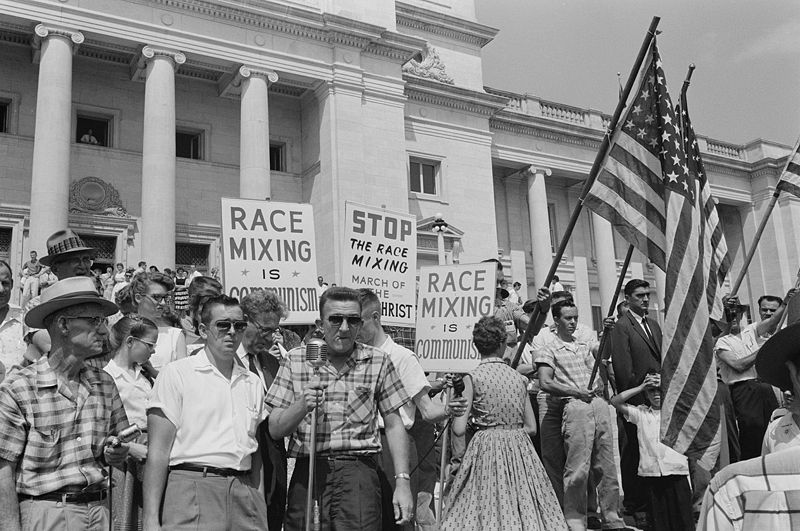

"People tend to think that those who don't think the way they do have
something wrong with them." Not a very extraordinary observation, but
no less interesting for that.

Social psychologists talk about a cognitive bias called "false
consensus", which consists of people's tendency to see "their own
behavioral choices and judgments as relatively common and appropriate
to existing circumstances while viewing alternative responses as
uncommon, deviant, or inappropriate".

All fundamentalism starts from this notion of false consensus: "what is
good for me is good for everyone", "this policy is the right one and
the best for the state and its citizens, and nobody with half a brain
can question it", "the Koran is a book that preaches hatred, so it
has to be burned", and so on, an endless list of examples.

Professor [Lee Ross](http://en.wikipedia.org/wiki/Lee_Ross), of
Stanford University, ran
[a series of experiments](http://nosolofreud.wordpress.com/2010/01/18/el-falso-consenso/)
in 1977, which allowed him to investigate this phenomenon. And the
conclusion of that study is that we are terrible predictors of other
people's behavior.

That study shows how terrible we are at predicting what others will
do. Think about the consequences of this:

> "... to think that, for example, our idea that the elderly are
> useless people can lead us to develop negative behaviors toward
> them, but if on top of that we believe it is something everybody
> thinks, there is no reason whatsoever to change that cognition.

Besides, radical attitudes toward people with different beliefs are
the order of the day; pinning negative personality traits on those in
"the opposing camp", without even knowing them at all (*mind you, in
this study the people who chose the opposite didn't even exist*), can
lead to very negative social consequences such as discrimination or
marginalization, because if we already *know* they are bad people, why
would we bother getting to know them better?"

Anyone who has been in the unpleasant position of arguing with a free
software fundamentalist has come face to face with this phenomenon.

It may also be what Freud called the "narcissism of small
differences", which Joel Spolsky captures very nicely
in ["Fork
It!"](http://blog.stackoverflow.com/2010/09/fork-it/). Because not
even among those who "agree on the fundamentals" is there consensus, as
this clip from Life of Brian, by the brilliant Monty Python, shows:

So which side are you on: those who use Linux, or GNU/Linux? And
remember, everybody knows that free software is the key to developing
the IT industry in Chile and Latin America.

:D
