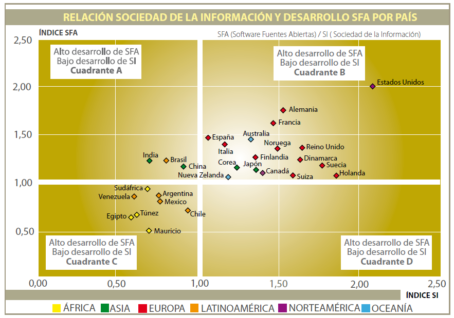

Over at [Manzana Mecánica](http://www.manzanamecanica.org/2010/09/panorama_internacional_del_software_libre.html)
they mention a
 [report](http://web.cenatic.es/web/index.php?option=com_phocadownload&view=category&id=1%3A&download=33%3A&Itemid=20&lang=es)
on the international landscape of open source software in 2010.
Nice study, a bit long. When I started leafing through it, a series of
charts like this one caught my eye:

What do those charts mean? (there are several in the report)

The horizontal axis is the information society development index, and
the vertical axis is the open source software (OSS) development index.
The quadrants are marked off too; the idea is to show us the magic
quadrant (top right), which is supposedly the best.

Aha!, says the OSS Taliban, the more open source code there is, the
better societies do on their information society development index. But
that's not it(\*)!

Well, the report's authors refrain from saying anything that crude.
After all it's only a landscape, a glance at how things stand, so there
are no hard conclusions of that kind. Still, I read the executive
summary, which says, in its last paragraph (where the conclusions
normally go, right?):

> The open source software development model is a globalizing model
> in which the actors take part over the Internet in different projects
> in an environment of cooperation, regardless of the nationality of
> the actor or of the project, with no differences by geographic area
> either in how the communities operate or in the associated business
> models.

Ha!, I say. And why am I laughing? Because of this:

> The **cloud computing** model is a globalizing model in which
> the actors take part over the Internet in different projects in
> an environment of cooperation, regardless of the nationality of the
> actor or of the project, with no differences by geographic
> area either in how the communities operate or in the associated
> business models.

Not long ago, reading an article on the opportunities of cloud
computing for developing countries (or emerging ones, as they are
called now), I read a conclusion almost identical to that paragraph
above, so I couldn't resist the experiment of swapping cloud computing
for open source software development and seeing what happened, and
apart from a couple of details that would need adjusting, it says
basically the same thing.

Isn't it funny?

(\*) For the clueless: there are many ways to interpret this
correlation, but the simplest and most logical one (what was it
[Ockham](http://es.wikipedia.org/wiki/Navaja_de_Ockham) said?) is that
OSS will always be correlated with the level of development of the
information society; this is tautological. A more developed information
society means more programmers and more universities, which will
obviously produce more open source software! These indicators don't
actually prove anything.
