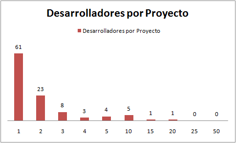
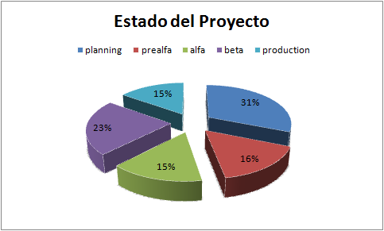
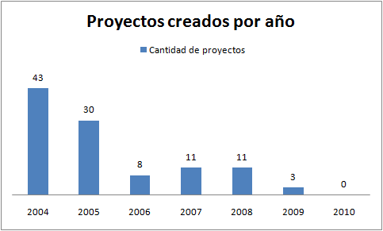
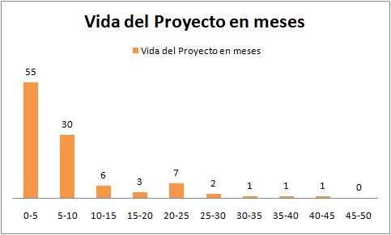

"Talk is cheap, show me the code," [says Linus Torvalds](http://lkml.org/lkml/2000/8/25/132).

Marco Zúñiga recently threw down a challenge, an [acid test
for the Chilean open source
community](http://blog.maz.cl/2010/09/test-acido.html). The idea is to
put what Linus Torvalds says to the test: whether these communities
actually move [from talk to action](/en/blog/lnds/2010/10/04/what-counts-is-action-not-words/).

As it happens, a few weeks ago I decided to look into the open source
repositories we have in this country, mainly prompted by a
[curious incident](http://groups.google.com/group/liberaciondigital/browse_thread/thread/bc1398b6f9524682/?pli=1)
involving the ChileForge site (more background
[here](http://www.malware.cl/?p=7364)). So I decided to check what had
become of this community, and set about analyzing the ChileForge
repository. Below I share the result with you. I think it is a good
piece of evidence to bring to the debate on the viability of open
source in Chile, or at least, for those interested in collecting that
dinner from Marco, now you'll know where not to look ;)

Description of the site, taken from its home page:

> *"ChileForge is a project driven by the Computer Science Department
> of the Pontificia Universidad Católica de Chile, which seeks to
> contribute to the spread and development of software in Chile, under
> the Open Source model."*
>
> Cutoff date for this analysis: September 16, 2010

**Summary**: 52% of the projects have released some product, which
doesn't guarantee it is anything usable. The average number of
developers per project is 2.2. There has been no activity on the site
for 6 months. Only 1 project shows activity in the last year, and only
2 projects show activity in the last two years.

Background:

**Registered users**: 1,096

**Registered projects**: 193

**Cataloged projects**: 106

The analysis went on using the 106 cataloged projects as its base.

**Developers**: the idea is to look at participation per project, to
determine how community-driven the projects are.

-   Total developers: 235

-   Average team size: 2.22 \[developers / project\]

-   58% of the projects have only 1 member

-   22% of the projects have only 2 members

-   The distribution of developers per project is as follows:

This chart shows the distribution:

The vertical axis is the number of projects; the horizontal one is the
number of developers (members) signed up to each project.

The two projects with the most users are:

-   Sistema Centro Médico 2005
    ([http://chileforge.cl/projects/tec](http://chileforge.cl/projects/tec/))
    with 16 members, created on April 7, 2005, whose only released file
    is a PHP class for sending messages using SMTP (imported from an
    earlier version of the
    [PHPMailer](http://sourceforge.net/projects/phpmailer/) project on
    sourceforge).

-   Rizoma (<http://chileforge.cl/projects/rizoma/>) has 15 registered
    members, but it is a project that decided to migrate to
    [Savannah](http://savannah.nongnu.org/p/rizoma), apparently because
    of support problems with ChileForge. This project seems to be still
    alive (they have a [blog](http://www.rizoma.cl) where they report
    that version 1.0 was released for FLISoL Santiago 2009).

**Project maturity**

The site lets projects be cataloged by their degree of maturity. The
possible states are: Planning, pre-alpha (I suppose in this state there
will be some prototype), alpha (a first version without much
debugging), beta (with some bugs; users are already starting to use
it), production/stable (the project is already in production), and
mature (that is, the product now stands on its own and gets
maintenance, or new versions are being planned). The distribution is
summarized in the following chart:

The classification is dubious. For example, there are projects that
have released code that looks quite usable, yet they show up as being
in the planning stage. In one case
([xanubis](http://chileforge.cl/projects/xanubis/)), the project is
cataloged as Production/Stable, yet it has not released a single file,
and has only a message that says _"We're just about to start the
Xanubis Project"_.

The interesting part is seeing how many projects have released some
product (downloadable files). For this we counted the projects that had
some file available for download. Only 52% have released some product.
But, I insist, the quality of these deliverables is dubious; you would
have to download the files and analyze them to give a more precise
diagnosis of the projects' maturity. From the little I looked at, I can
say they were almost always files in their first version, or just some
ancillary files (like the case mentioned above).

**Version control**: 7 projects (7%) have no version control of any
kind; 86 projects (81%) have CVS set up, but the repositories are
gathering cobwebs, since they have never been used. Of those left
(13), usage is minimal, with no more than 2 or 3 commits per
project. This is where the technical immaturity of the ChileForge
community shows the most.

**Activity**

41% (43) of the projects were created in 2004, 28% in 2005. This is the
distribution:

To measure a project's lifetime we counted the number of days from when
the project was created until the most recent version of any of the
project's deliverables was released. For example, the longest-lived
project (reqadmin) was registered on May 30, 2005 and has released 6
files; the last one is version 0.4 beta, dated June 8, 2008. Between
the registration date and the last beta, 1,105 days (37 months) went
by.

By this criterion, the average lifetime is 7.6 months, and the median
is 4.5 months. The distribution of project lifetimes is shown in this
chart (expressed in months):

The height of the bars represents the number of projects that fall in
the range. The ranges are 5 months wide. For example, the first bar
indicates that 55 projects have a life of between 0 and 5 months.

The other parameter is how much activity the project has had in recent
months. In this case what we measure is the date of the last product
released (the same parameter used to measure the project's "life").
Here the data is discouraging:

-   Activity in the last 6 months: no project shows any activity.

-   Activity in the last year: 1 project

-   Activity in the last 2 years: 2 projects

If we count the news items published on the front page, we have:

-   1 news item from 2010, reporting that the Chileforge.cl domain has
    been recovered

-   One news item in 2009

-   28 messages in 2008

**Conclusions**

ChileForge is a community with very little activity in recent years.
Although in its early days (2004) it showed great momentum, its use
declined over time, to the point that this year it was inactive for
several months.

For a 6-year-old community, this degree of inactivity is a bad
indicator. Consider that open source communities have a high degree of
participation and activity
([Sourceforge](http://sourceforge.net/), [GitHub](http://github.com/),
even [CodePlex](http://www.codeplex.com/), Microsoft's open source
repository).

What is going on with ChileForge? Could it be that users prefer to
_host_ their projects on the international repositories? Lack of
publicity? Or are there other, deeper causes that explain this lack of
activity? I invite you to debate this case.

In any case, I promise that next year I will repeat this exercise, and
we will review the state of this community once again.
