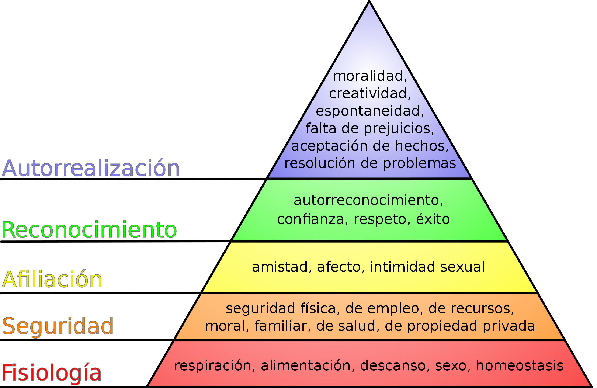
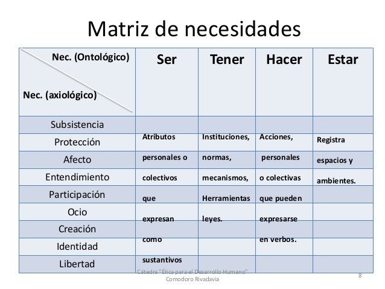
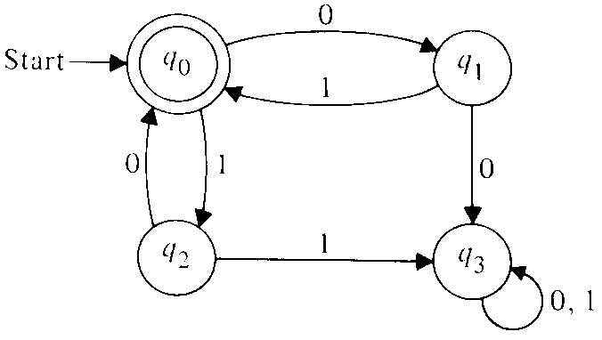

"Soy feliz" ("I am happy"), some people say. To the people I know and love I say 
_"you can't be happy"_, and the reason is very simple: happiness is
a state. You can **estar** happy (be in that state), but you can't **ser** happy (be it, as a trait).

And yet we say "estoy enamorado" ("I'm in love"). We have no trouble admitting
that love is temporary, but we won't admit it of happiness.

Spanish has the advantage of splitting the verb "to be" in two, *ser* and *estar*,
something other languages don't have. It's a very powerful tool,
because it gives philosophical thinking dynamism. If Heidegger's mother
tongue had been Spanish his philosophy would have been
simpler, but his verdict on ontology is quite valid, and
it has to do with its static nature. That's why I distrust
ontologies: they don't account for the dynamic nature of
processes, and they lead to static, rigid thinking.

Let me try to explain. When it comes to happiness, the general view is
static, ontological, and this shows in the use of the verb *ser* to
refer to this quality: "one must be happy", "you have to aspire to
happiness", "you have to pursue happiness", "you make me happy",
"I am happy", and so on. But life is not static. With a
dynamic view, like life itself, a process view,
understanding becomes possible. Things always change and you can't
control that change, and once you understand that, the anxieties start to
fade.

Today I'm cheerful, but something may happen around me that knocks me out of
that state, and of course my reaction will depend on the state
I'm in at that moment. If I'm stressed I'll react worse to
bad news than if I'm calm, or if I'm happy the blow
may be more devastating.

When we talk, our understanding of what the other person
is saying is affected by our internal states, leading us to
misunderstandings, or to wrong judgments.

Let's look at another example. There's a model of human motivation that is taught
these days, especially in universities. I mean [Maslow's
pyramid](http://es.wikipedia.org/wiki/Pir%C3%A1mide_de_Maslow).

This theory tries to explain human motivation. It's a static,
hierarchical model, which holds that "as the most basic needs
are satisfied (bottom of the pyramid), human beings
develop higher needs and desires (top of the
pyramid)." On top of that, the model is taught badly, but that's a
story for another day.

What this model creates, unconsciously, in those who study it is
a need: the idea that you have to work through the stages to reach
the summit of "self-actualization". It's an illusion produced by the
static nature of the model.

However, if we look at things more dynamically, these pressures
to achieve success disappear. The Chilean economist Manfred
Max-Neef proposes a more interesting list for understanding human
motivations: subsistence, protection, affection, understanding,
participation, leisure, creation, identity and freedom (he later added
transcendence), and proposes organizing it in a matrix:

Max-Neef's model is interesting, and more reassuring. It doesn't impose
that pressure that you have to be rich to be happy. It's a step forward
toward this idea of dynamism.

In computing we use [state
machines](http://es.wikipedia.org/wiki/M%C3%A1quina_de_estados), which
let us model the different stages you go through in the
execution of a sequence of actions.

A state machine is a model of the behavior of a system with
inputs and outputs. In this model the outputs depend not only on the
inputs, but on the current state the machine is in.

Maybe a state machine model, or a [nondeterministic
automaton](http://es.wikipedia.org/wiki/Aut%C3%B3mata_finito#Aut.C3.B3mata_finito_no_determinista),
could turn out to be a better model of human motivations. I'll
just leave the idea out there, but I think it's good to start from the notion that
we are happy, or we are sad, at different times, and that we keep
changing and reacting to our surroundings. I think that more dynamic
way of thinking is healthier in the long run, and lets you face life better.
At least it works for me.

In the end, and in keeping with the Mentat maxim, you can't understand life
by theorizing about it, [you have to move with the flow of the
process](/en/blog/lnds/2010/05/27/on-processes/). That
is, you have to live.
