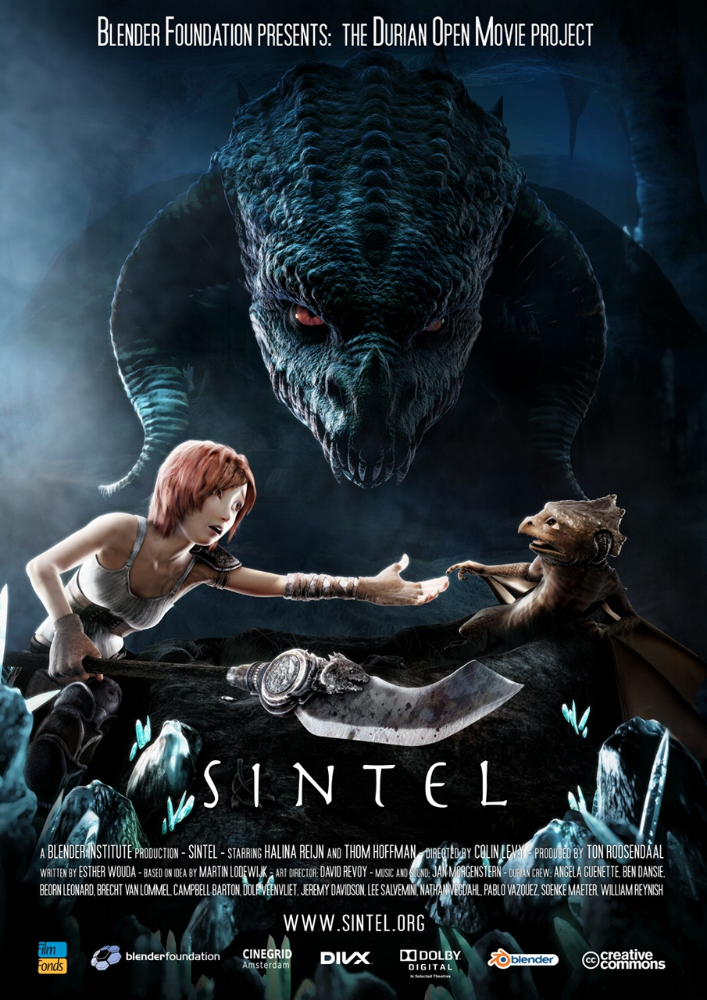

Good, now that I have a bit of your attention on the 
[state of free software in Chile](/en/blog/lnds/2010/09/19/state-of-open-source-in-chile-chileforge/),
let me tell you about a couple of cases that may bring a little
[understanding](/en/blog/lnds/2010/05/20/intelligence-education-and-understanding/)
to the subject.

I want to talk about 2 projects that owe their existence to this
powerful idea of free software, and through these examples I want
to figure out the secret behind the success of a free software project,
or one based on free software. My aim is to find the fundamentals
that make these projects work. I'm convinced that a lot of
people who talk about free software have no idea what they're talking about, and
so they create wrong expectations and ideas, which, badly applied,
can be disastrous.

In this first post we're going to focus on a project that uses free
software, where the focus is not on developing code (although that did turn out to be
necessary). Here the focus is on using the free software available to
build a piece of art and share it, and of course to set up a
sustainable industry that makes it possible to earn money from the project.

I'm talking about the short film [Sintel](http://www.sintel.org/), which
I found out about thanks to this
[post](http://www.bitacoravirtual.cl/2010/09/30/estreno-on-line-de-sintel-open-movie-de-la-fundacion-blender/)
on the excellent Bitácora Virtual by [Andrés Moya](http://www.bitacoravirtual.cl/curriculum/).

Sintel is an Open Movie, which means all the production
material is available under a Creative Commons license, so
derivative works can be created from this film.

In the team's own words:

> "Sintel" is an independently produced short film, initiated
> by the Blender Foundation as a means to further improve and validate the
> free/open source 3D creation suite Blender. With initial funding
> provided by 1000s of donations via the internet community, it has
> again proven to be a viable development model for both open
> 3D technology as for independent animation film.

Blender is 3D modeling software created by 
[Ton Roosendaal](http://en.wikipedia.org/wiki/Ton_Roosendaal), a Dutch programmer
and entrepreneur. In 1998 Roosendaal had founded a company called
NaN to sell and distribute the software. By 2002 NaN was
bankrupt.

Despite the bankruptcy, Roosendaal wanted to keep developing the
software. The solution was to pay his creditors 100,000 euros for the
Blender source code. To get there he created the Blender
Foundation, whose first goal was to raise the money to free the
code. Here we're literally talking about freeing the source code ;).

The foundation is sustained by donations, whose main purpose is
to employ Roosendaal as full-time lead developer. The foundation's
main goal is "to give the worldwide internet community
access to 3D technology in general, with Blender as the core".

The Blender Foundation has produced [several independent
projects](http://www.blender.org/features-gallery/blender-open-projects/)
before, including shorts and games. Blender itself has
been used in commercial films, such as Spider-Man 2 and the recent
Argentine film [Plumíferos](http://www.plumiferos.com/).

Here's the film Sintel. I hope you enjoy it:


