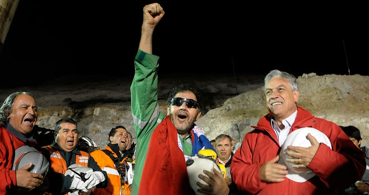

President Piñera has said that [this rescue](http://tecinn.blogspot.com/2010/10/la-capsula-fenix-como-artefacto.html)
was done "a la chilena", the Chilean way, and by that he means to give the
phrase a positive sense. That seems fine to me, and I endorse the president's
intent. "The Chilean way" should mean doing things
right.

But let's not forget that these miners were trapped for 70 days
because things at that mine were done "the Chilean way".

Let's work to change, in a positive direction, but let's not forget, as
we have been doing. That is what evolving means.

(photo taken from [www.gobierno.cl](http://www.gobierno.cl/),
under a CC attribution license)
