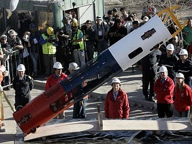

 
Amid all the celebration over the rescue of the 33 Atacama miners, a
historical image comes to mind. When a victorious Roman general
entered Rome in triumph, leading the victory parade, he was
accompanied in his chariot by a loyal slave, who held a
laurel wreath over his head and kept whispering in his ear: _"Look behind
you. Remember that you are only a mortal"_ (Respice pos te! Hominem te
 memento!) \[1\]

And it's good to remember our limitations, especially now that our
engineering is being showered with praise, which it deserves, by the way. But there is
a technological lesson in this rescue that we shouldn't let slip by, and
[Juan Carlos Barroux](http://www.blogger.com/profile/11623145082042612187) explains it on his excellent blog [Tecnología e Innovación](http://tecinn.blogspot.com/2010/10/la-capsula-fenix-como-artefacto.html).

After [analyzing the technology of the famous Fénix capsule](http://tecinn.blogspot.com/2010/10/la-capsula-fenix-como-artefacto.html),
Juan Carlos offers the following reflection:

> The Fénix capsule is without a doubt an incremental advance, driven by the
> need to modify the earlier design in the face of requirements an
> order of magnitude harder. Chilean engineering showed its
> great strength in process management, following a
> meticulous testing protocol. The country showed itself for what it is: an
> orderly country where procedures work. A complete success
> in the eyes of the world. Good for the miners and good for Chile.

## **And yet, to me, we failed.**

I'll be called a killjoy, maybe with some reason, but it's when everything
is going perfectly that the seeds of defeat are sown. Let me argue my
case. Who owns the design? Who holds the IP (i.e.
Intellectual Property) of the Fénix capsule? Who started the process
to obtain the patent? I searched the patent
database, and quite simply nobody has started that process yet. Without reading
the agreements and contracts between the Government of Chile,
via [Codelco](http://www.codelco.com/), [ASMAR](http://www.asmar.cl/) or
whoever, and [NASA](http://www.nasa.gov/), it isn't possible to know whether
it was spelled out in some clause. I suspect that, the goal being
to rescue the miners alive, any secondary goal of
developing the mining cluster ended up, once again, in the bottom
drawer.

On the other hand, **which Chilean university took part in the design
process?** 

As far as I know, none. None. I find it very hard
to believe that the mechanical engineering departments of the [Universidad
de Chile](http://ingenieria.uchile.cl/),
the [UTFSM](http://www.utfsm.cl/), the [PUC](http://www.uc.cl/),
the [Universidad de Concepción](http://www.udec.cl/), to name just
a few, aren't capable of taking the requirements and, building on
similar solutions such as those described in
patent [4,254,994](http://patft.uspto.gov/netacgi/nph-Parser?Sect2=PTO1&Sect2=HITOFF&p=1&u=%2Fnetahtml%2FPTO%2Fsearch-bool.html&r=1&f=G&l=50&d=PALL&RefSrch=yes&Query=PN%2F4254994),
designing, building, testing, validating, patenting and generating value
with a solution similar to the Fénix capsules, for whose design
we had to call in none other than [NASA](http://www.nasa.gov/).

Why? What happened? Do our politicians and leaders not trust
homegrown designs? If that's the case, then the ghost
of [Transantiago](http://en.wikipedia.org/wiki/Transantiago) still haunts us
and we are condemned to perennial underdevelopment. Are we excellent
engineers of production processes who, when it comes to designing something
new, don't know where to start? It's possible, and that would explain
why it took a foreign systems engineer to tackle a
new and not clearly structured problem. I'm talking about systems in
general, the systems of General Systems Theory (GST), and not
just the ones made of bits.

In Chile, systems engineering is not offered as a degree at the
local universities, when that is precisely the specialty
required to tackle problems that are new and, above all,
unstructured, that is, incompletely specified. "Let's take advantage of this
accident to make a leap forward," President Sebastián
Piñera said today. So let's take advantage of it.

(the bold is mine).

Juan Carlos left me thinking, because he's right. Why do we
always have to [turn to foreign technology for help](/en/blog/lnds/2010/10/17/reflections/) 
to solve our problems? It's true, we seem to be good at
following procedures, using technology, and solving and confronting problems
when they show up.

We caused the drama of the San José mine, and 
[we were capable of solving it](/en/blog/lnds/2010/12/17/the-chilean-way/). We are
reactive, not proactive.

Maybe that's why we're such a mess, and so bad at planning:
because we're confident that if a problem comes up we'll be able to
solve it. "Let's just push ahead, and we'll fix whatever screw-ups
are left along the way."

[^1]: This figure is known as Memento Mori, remembering our
mortality (how nice it is to know a little about the classics).
