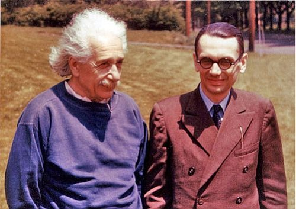

 

If Pinocchio says his nose will grow, and it doesn't, he'd be lying.
But when Pinocchio lies his nose grows, and if his nose grows
then he'd be telling the truth. So what the hell is supposed to happen
after Pinocchio says that sentence?

This is a restatement of the old [Liar's Paradox](http://es.wikipedia.org/wiki/Paradoja_del_mentiroso). The
interesting thing is that this paradox plays a fundamental role in the
solution of an important problem in mathematical logic, and along the way in
the development of modern computing (and without that there would be no
computers, no web, no blog, no twitter, and we wouldn't be telling this
story).

In the early 20th century mathematicians were trying to build
the foundations of mathematics, to turn it into the most beautiful and
purest of the sciences. On these solid-rock foundations, the other,
more complex areas of mathematics would rest, and grow.
Eventually every proposition in mathematics could be
declared, uniquely and crystal clear, either true or false, and whenever
a mathematician proved a theorem little bells would ring in heaven, and
an angel would get its wings. How lovely!

One of the greatest works embodying this ideal was that of
Whitehead and Russell, set down in their three-volume
magnum opus [Principa Mathematica](http://es.wikipedia.org/wiki/Principia_mathematica). The
tremendous effort of these two thinkers, which took them years, reaches
its peak when, on page 379 of the first volume, the
proof that 1+1 = 2 is set up, a proof that is finally completed on page 86
of the second volume! (thank goodness)

At that time there was a great mathematician named Hilbert who posed a
series of problems to his fellow mathematicians. It is suspected that, having
fallen asleep reading the Principia, he decided to have other enthusiasts
summarize the three heavy volumes for him, and so he posed what is known by the
grandiose name of **[Hilbert's Second Problem](http://en.wikipedia.org/wiki/Hilbert's_second_problem)**, which
in plain terms translates to: "can somebody tell me
whether this s\*\*\* by Whitehead and Russell is consistent!?"

That is, what Hilbert wanted was for some pimply thesis student to
tell him whether those three doorstops full of mathematical gibberish
contained internal contradictions.

And good old Kurt Gödel solved the problem, and found that the
answer was 42\..... nooo, just kidding, the answer to Hilbert's second
problem is negative.

Gödel, considered the greatest logician of the 20th century, seen here in
the photo out for a stroll with one of his buddies,
was quite a character. 

The story goes that his scientist friends
got him asylum in the United States to get him out of Austria and away from
the Nazi regime. In time they convinced him to accept
American citizenship. Rigorous as he was, he decided to do a
logical analysis of the United States Constitution, and discovered
that, without stepping outside the Constitution, it was possible to establish a
fascist-style dictatorship in that country (how odd, don't you think?). Worried,
he told his friends that he refused to swear allegiance to this country under those
conditions, unless some changes were made to the
Constitution. It took some convincing, but they managed to restore his confidence
and he agreed to swear loyalty to the American Constitution, a
prerequisite for being granted citizenship. Well, the official who
was to administer the oath asked him where he was from, and on hearing his answer, the
clerk remarked how good it was to be in a nation where
democracy protected them from tyranny taking hold. Big
mistake! Poor Gödel, hearing this, shot up like a spring and started
explaining to him that he was wrong, and that the Constitution had a series of
logical flaws, and at that point his friends had to step in,
shut him up, and calm him down so the ceremony could go on.

Well, before that anecdote took place, and while he was still a shy thesis student,
Kurt Gödel proved his famous incompleteness theorems. And to do so he
used a variant of the liar's paradox. Basically what
Gödel did was formulate a proposition that says "This proposition is
unprovable". If the proposition is unprovable, then it is true,
and therefore the formulation of arithmetic is incomplete (because
there is a proposition that hasn't been proved). On the other hand, if the proposition can
be proved, that is, it is false, then the formulation of the
theory is inconsistent.

The interesting thing is that Gödel's proof involves building
a kind of logical machine, a rudimentary computer that writes
logical statements following certain rules, which is what makes Gödel's
original proof long and intricate.

Today Gödel's result covers far more than number
theory and arithmetic, thanks to the precise notion of a computational
algorithm introduced by Alan Turing. Gödel's theorem is now
considered applicable to every formal axiomatic system.

What matters to us, in short, is that the work of Gödel, Turing
and other logicians and mathematicians of the early 20th century, who set out
to solve these abstract foundational problems of mathematics,
led to the development of the concepts of algorithms and of automatic
machines, which in turn led to the development of modern computing.

For the more technical among you, I recommend reading 
[World's shortest explanation of Gödel\'s theorem](http://blog.plover.com/math/Gdl-Smullyan.html).
