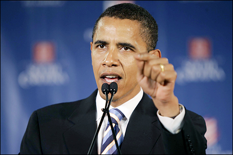
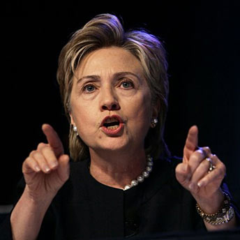

> "The more freely information flows, the stronger the society becomes,
> because then citizens of countries around the world can hold their own
> governments accountable. They can begin to think for themselves."
> \[\...\] "I can tell you that in the United States, the fact that we
> have free internet — or unrestricted internet access is a source of
> strength, and I think should be encouraged."
> -- Barack Obama in [a speech in China](http://forum.bodybuilding.com/archive/index.php/t-120390411.html) ([video](http://www.youtube.com/watch?v=J9zytXNgKMs)).

> "Censorship should not be in any way accepted by any company from
anywhere. And in America, American companies need to make a principled
stand\... This needs to be part of our national brand. I'm confident
that consumers worldwide will reward companies that follow those
principles."
>
> -- Hillary Clinton, [speech on internet freedom](http://www.indexoncensorship.org/2010/01/hilary-clintons-internet-freedom/comment-page-1/).

Taken from
<http://www.indexoncensorship.org/2010/12/wikileaks-internet-censorship-united-states/>;
there is [a Spanish translation at Manzana Mecánica](http://www.manzanamecanica.org/2010/12/wikileaks_los_ideales_de_internet_triunfan.html).

