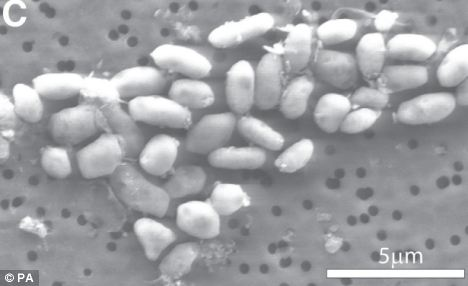

Since I grew up in
[Chuquicamata](/blog/lnds/2007/08/02/adios-chuquicamata/),
the copper mining town in northern Chile, at a time when pollution was
pretty high, mainly from the fumes coming out of the copper smelter's
smokestacks, I was always told that I had been exposed to arsenic
contamination, at least for the first 18 years of my life.

So you could say I am an arsenic-tolerant life form
:smile:

During my time at the [Escuela de Injeniería](http://ingenieria.uchile.cl/) (the engineering school; yes, it's spelled with a J), I met
Don José Tohá Castellá, who was researching biofilter technology for
cleaning up pollution, which ended up as an invention called the [Tohá
System](http://www.sistematoha.cl/), used to decontaminate water.

It was from this professor that I learned something interesting, and to
illustrate it I am going to turn to an old friend of the true nerd
(something every self-respecting geek has on a desk, on some wall or
printed on a T-shirt). I mean the Periodic Table of the Elements. Here
it is, with one touch-up: a little box around two elements, Phosphorus
(**P**) and Arsenic (**As**):

If you have trouble seeing it, click on the image.

As you can see, phosphorus and arsenic are in the same group of the
periodic table (column 15). This version of the table is a bit old:
arsenic and phosphorus are nonmetals, but nowadays arsenic is classified
as a semiconductor (such is fashion).

The important thing is that this fact, that they sit so close together
in the periodic table, tells us these elements share some properties.
The most important one, and the one Professor Tohá taught us, is that
Arsenic can displace Phosphorus, and vice versa, in the makeup of
certain molecules. That is why arsenic is poisonous: phosphorus is one
of the essential elements of life, and arsenic, having this ability to
displace phosphorus, disrupts biological processes and kills living
things.

**Rasputin and Coca-Cola**

They say that [Rasputin](http://es.wikipedia.org/wiki/Grigori_Rasput%C3%ADn),
the famous and sinister Russian monk, took small doses of arsenic every
day, which made him virtually immune to this poison and terrified his
murderers, who couldn't poison him, adding to his legend.

So it seems you can develop a certain tolerance to arsenic, and if what
they said about my hometown is true, the arsenic is in my body. Or was,
because according to Tohá, Coca-Cola, which contains significant amounts
of phosphorus (in the form of [phosphoric
acid](http://es.wikipedia.org/wiki/%C3%81cido_fosf%C3%B3rico)),
displaces arsenic from the body (and with all the Coca-Cola I have
drunk, I figure I'm rid of the poison by now).

And all this is because of last week's announcement of the supposed
discovery of a new arsenic-based life form, announced by NASA, which
stirred up a lot of anticipation, and even suspicions that it was a
cover story to draw attention away from Wikileaks' CableGate

**Alien life**

The problem is that several scientists have studied [the NASA
researchers'
paper](http://www.sciencemag.org/content/early/2010/12/01/science.1197258),
and they have been pretty critical. Professor Rosie Redfield of
the University of British Columbia [published on her
blog](http://rrresearch.blogspot.com/2010/12/arsenic-associated-bacteria-nasas.html)
an analysis of NASA's work, going so far as to say that if the
experimental data had been presented by PhD students to her committee,
she would have sent them back to take more careful samples and improve
their controls.

There is an assessment of this work in Spanish, [published at
Amazing.es](http://amazings.es/2010/12/08/arsenicleaks-la-vida-a-base-de-arsenico-hace-aguas/),
written by [José Miguel
Mulet](http://amazings.es/autor/jose-miguel-mulet/), professor of
biochemistry and molecular biology at the Polytechnic University of
Valencia.

The main claim of these NASA researchers is that these bacteria replace
the phosphorus in their DNA with arsenic. And that is where the problems
are, in the way this claim is demonstrated. I quote Mulet:

> "The authors prove it with radioactive labeling and see arsenic
> accumulating in the bacteria... but they show no direct data on
> biomolecules containing arsenic, such as a DNA structure solved by
> crystallography or a mass spectrometry analysis. It is one thing for
> it to be inside the house, and another for it to be part of the
> structure like any other brick."

> "There is an earlier experiment that raises suspicion. The cell is
> able to grow in a phosphate-rich medium with no arsenic... so it does
> not seem to be an essential element; that is, the biomolecules can
> incorporate either arsenic or phosphate, a surprising case of such
> important molecules having alternative compositions. There are no
> arsenic transporters as specific and efficient as the phosphate ones,
> among other things because arsenic is neither essential nor that
> common in the biosphere. So rather than a new form of life, it would
> be a more flexible form of life. And there are plenty more flexible
> forms, so it isn't that new."

So it doesn't look like we are facing a new arsenic-based life form
(something that would widen the range of possibilities for
extraterrestrial life).

## **The vacuoles, the vacuoles!**

But there is another interesting objection that Mulet points out:

> There is another detail that has gone more unnoticed and that made me
> suspicious. According to the authors, when the bacteria grow in an
> arsenic-rich medium they are larger, *because their vacuoles increase
> in size*.

For the less initiated, vacuoles are organelles that eukaryotic cells
also have and that serve as the garbage can, among other things. It is
where the cell stores everything that bothers it and that it cannot get
rid of. This organelle is not very common in bacteria; it is found only
in some families such as the sulfur bacteria.

A typical strategy for dealing with a toxic compound is to accumulate
it in the vacuole, that is, to take it from the medium and stuff it in
the garbage can so it doesn't get in the way... and it turns out that
the bacteria grown in arsenic have a full garbage can, and have also
taken up a lot of arsenic. *Couldn't it be that there is a lot of
arsenic in the garbage and very little in the DNA?* Besides, the
increase in vacuole size is a clear sign of cellular stress. We are
doing something to those bacteria that bothers them. Any ideas?

So the suspicions about this "discovery" start to grow, because NASA
needs to show results to sustain its budgets, so it would not be strange
if they had rushed to announce a finding with flimsy evidence, on top of
the very unfortunate timing of the announcement, which feeds the
conspiracy theories.

But besides, a discovery of arsenic-based life would have shaken the
scientific community, and it seems that hasn't happened. This discovery
has been met with great skepticism, and with [dissenting
voices](http://sonicando.com/?p=1907).

Looks like the arsenic aliens will have to wait.

