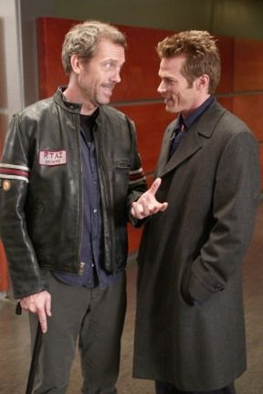

 
 
> Dr. House: Nothing matters. We're all just cockroaches, wildebeests
> dying on the riverbank. Nothing we do has any lasting meaning.
>
> Evan Greer: And you think I'm miserable?
>
> Dr. House: If you're unhappy on the plane, jump out of it.
>
> Evan Greer: I want to, but\... I can't.
>
> Dr. House: That's the problem with metaphors. They need
> interpretation\... Jumping out of the plane is stupid.
>
> Evan Greer: But what if I'm not in a plane? What if I'm just in a
> place I don't want to be?
>
> Dr. House: That's the other problem with metaphors. Yes, what if
> you're actually in an ice cream truck, and outside are candy and
> flowers and virgins? You're on a plane! We're all on planes. Life is
> dangerous and complicated, and it's a long way down.
>
> -- Season 4, Episode 14

Amen.
