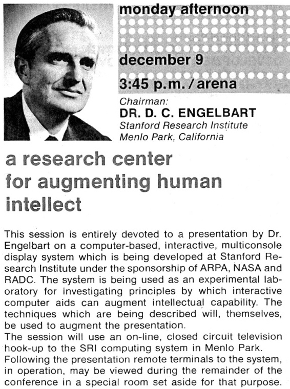
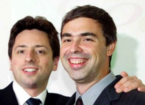

> "Perspective is worth 80 IQ points"\
> -- Alan Kay

[Alan Kay](/en/blog/lnds/2010/05/26/alan-kay/) originally
meant to go into biology; it was almost by accident that he
ended up in computing. In [one of his
talks](http://www.windley.com/archives/2006/02/alan_kay_is_com.shtml)
a few years ago, Kay admitted that if he wanted to go back to
microbiology it would take him a long time to catch up, given the incredible
progress that discipline has made over the years. The same, he says,
is not true of computer science, which
strikes him as stagnant.

> "Much of what is wrong about our field is that many of the ideas
> that happened before 1975 are still the current paradigm."

And Alan Kay has been saying it for a while. This 1997 video from OOPSLA
shows what could be done with computers in 1972 (the demo starts
at 3 minutes 40 seconds):

The mouse, one of the *great innovations* of the 1980s, was
first presented by Douglas Engelbart in [The Mother of All
Demos](http://www.dougengelbart.org/firsts/dougs-1968-demo.html), in
1968. That legendary demonstration showed, besides the mouse and for the
first time, data networks, teleconferencing (with
video), email, hypertext and real-time collaborative
text editing (did somebody say Google Buzz Wave?).

All the inspiration for Engelbart's work came from Vannevar Bush's
1945 article "As We May Think". Many of you
have probably never read it; [here
it is](http://www.theatlantic.com/magazine/archive/1945/07/as-we-may-think/3881/).

That long article introduces the concept of the
[Memex](http://en.wikipedia.org/wiki/Memex), a device that
anticipates the idea of our computers using hypertext to
navigate information, concepts that became the foundation of
Tim Berners-Lee's World Wide Web.

In 1992 [Michael Buckland
criticized](http://people.ischool.berkeley.edu/~buckland/goldbush.html)
Vannevar Bush's vision as incomplete and as failing to understand "information
science", given his low opinion of indexes and
classification schemes: "Bush thought that the creation of arbitrary associations
between individual records was the basis of memory, so
he wanted a \'mem(ory-)ex\', or \'Memex instead of index\'. The
result was a personalized, but superficial and inherently self-defeating design."

If you look at the first attempts to classify the information on the web,
they all clung to the idea that information had to be indexed.
Nobody seemed to consider the intrinsic value of
hyperlinks, the thing Vannevar Bush championed. Buckland had managed to
impose "the correct view of information science".

The revolution in search, the real innovation of that era, came
from the work of Larry Page and Sergey Brin and their concept of PageRank,
which places intrinsic value on Vannevar Bush's ideas and defies the
conventional wisdom of Buckland's "information science". Page and
Brin took a different perspective from their competitors, and that is how
they won.

The great advances in computing have come about that way. Everyone
else just keeps improving and optimizing problems already solved. Few
people in computing bother to study their past, so they repeat the same mistakes
over and over, or simply reinvent the wheel.

We keep stagnating. Once we take one small step, we get stuck
in a loop of micro-optimizations, without making any significant
quantum leaps. That is Alan Kay's complaint, and he is largely
right.

Today we have plenty of "Bucklands", especially in academia, telling
us that this or that is the correct paradigm and shutting down any
attempt to approach problems from another perspective.

Every advance has to break with the established order. We need to look
back, and understand and take ownership of what has been handed down to us. We need to step off
the narrow paths our teachers laid out for us. In short,
we always need to take up new perspectives; only then are we in a position
to innovate.

