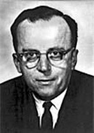

> **Washington 25, D.C. April 23, 1963**
>
> **Memorandum**
>
> **For: Members and Affiliates of the Intergalactic Computer
> Network From: J. C. R. Licklider\
> Subject: Topics for Discussion at the Forthcoming Meeting**

That is how one of the most interesting, and probably
one of the most influential, documents in the history of technology begins: the famous [Memorandum for Members and Affiliates of the Intergalactic Computer Network](http://www.kurzweilai.net/memorandum-for-members-and-affiliates-of-the-intergalactic-computer-network),
by Joseph Carl Robnett Licklider.

When I read this memorandum(1) I found a use case that
describes the need for distributed operating systems, for defining
"languages" that allow interoperability between different systems,
RPC, remote process execution, the description of a
service-oriented architecture, integration between multiple programming
languages (a Fortran program can call routines written in
Algol that live on another machine somewhere on the
network), the description of virtual machines (in the sense of the JVM,
or .Net's CLR), libraries loaded dynamically at run time
(DLLs, .so), the concept of the mashup!, the concept of cloud
computing (which node of the network runs a task is
transparent to the user) and no end of other elements, some of which we are only now
developing. Please read it; [here it is](http://www.kurzweilai.net/memorandum-for-members-and-affiliates-of-the-intergalactic-computer-network).

Most important of all, this memorandum, along with Licklider's inspiration and influence
on Ivan Sutherland and Robert Taylor, was what
drove the creation of ARPANET and, later, the Internet. There is
a line that runs from Vannevar Bush to Tim Berners-Lee, and it passes through
Licklider.

But Licklider had a vision that is partly captured in that memo
and spelled out in more detail in a 1960 paper, published in the IRE
Transactions on Human Factors in Electronics, called "[Man
Computer
Symbiosis](http://www.columbia.edu/~jrh29/licklider/man-computer_symbiosis.html)":

> *Symbiosis*

*The fig tree is pollinated only by the insect
Blastophaga grossorun. The larva of the insect lives in the ovary of
the fig tree, and there it gets its food. The tree and the insect are
thus heavily interdependent: the tree cannot
reproduce without the insect; the insect cannot eat without the tree;
together, they constitute not only a viable but a productive and thriving
partnership. This cooperative "living together in intimate association, or
even close union, of two dissimilar organisms" is called
symbiosis.*

> *"Man-computer symbiosis" is a subclass of man-machine
> systems. There are many man-machine systems. At present,
> however, there are no man-computer symbioses. The purposes of this
> paper are to present the concept and, hopefully, to foster the
> development of man-computer symbiosis by analyzing some
> problems of interaction between men and computing
> machines, calling attention to applicable principles of
> man-machine engineering, and pointing out a few questions to which
> research answers are needed.(\*)*

Licklider called this vision Machine-Aided Cognition (MAC), and it
took shape as a project at MIT, Project MAC, which included
building an operating system that would implement
multitasking, filesystems, regular backup
policies, time sharing and multi-user environments. In
fact, C and Unix were a reaction: a way of carrying out Licklider's program
more simply (remember [worse is
better](/en/blog/lnds/2014/01/25/garbage-collection/)?).

Licklider was an inspirer, a man who had the chance to
lead and connect a group of brilliant minds. His intergalactic
network was a network of people who, under this thinker's
influence, made great contributions to information technology. From
the PC to the internet, every one of those technologies carries the influence of
Licklider's ideas. That is what I call motivating.

Notes:

(\*) I promise that one day I will write something about this paper of
Licklider's, because it is very interesting.

\(1\) I learned Licklider's story from this [remarkable
post](http://www.moserware.com/2008/05/who-is-this-licklider-guy.html)
by Jeff Moser.
