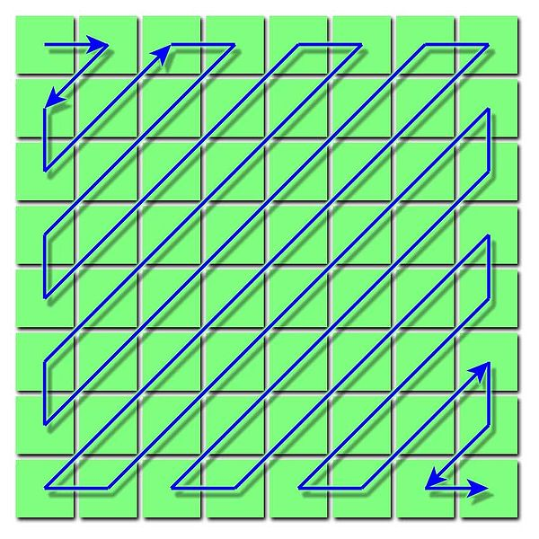

 
Given how well [a simple test](/en/blog/lnds/2010/12/23/a-simple-test/) did, 
I'm going to rerun a challenge I posted 2 years ago. Answers are welcome (that time
only one answer came in, and it was wrong :()

Produce a zig-zag array.

A zig-zag array is a square array of the first N2 integers,
where the numbers run from lowest to highest, laid out in a
zig-zag along the anti-diagonals of the matrix (see the
figure).

For example, if N is 5, the program must produce this array:

0   1   5   6  14\
2   4   7 13  15\
3   8 12 16  21\
9 11 17 20  22\
10 18 19 23  24

No cheating. Don't look up the answer on Google or Stack Overflow.
Think it through and write it in your favorite programming language;
the more exotic the language the better, and there might even be a prize ;)

-   This may look like a brain teaser, and a rather useless one, but the
    truth is that this kind of array is used in the JPEG image
    compression algorithm.

