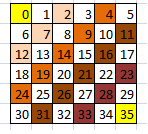
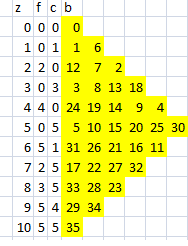

There have been several contributions to the zig-zag challenge. If you haven't
read it yet and feel like taking the test, then before
going any further [read the challenge](/en/blog/lnds/2011/01/05/a-harder-test/) and
try to solve it.

The most concise solution I know of is on the [Rosetta
Cod](http://rosettacode.org/wiki/Zig-zag_matrix)e site. It is written in the
[J language](http://www.jsoftware.com/) and goes like this:


>      ($ [: /:@; <@|.`</.@i.)@,~ 5

Incredible, isn't it? In this case it is the solution for a 5 x 5 matrix. There is an explanation of that code
[here](http://rosettacode.org/wiki/Talk:Zig_Zag#reading_the_J_examples),
but before you set off trying to understand it, let's see what
some readers answered, and then I'll show you my solution.

If I had to pick 3 finalists, I like the solutions by [Luis
Cárdenas](/en/blog/lnds/2011/01/05/a-harder-test/#comment-959)
(in Perl), [Javier
Rovegno](http://code.activestate.com/recipes/577536-un-arreglo-zig-zag-es-un-arreglo-cuadrado-de-los-p/)
(in Python) and [Francisco
Rojas](https://gist.github.com/772690/b5ca761dd6d7919790ea7103f70c430d217da3b1)
(in Java). In particular, I think Francisco's is the most succinct;
Luis made an interesting optimization and takes second place.

Javier's solution is representative of the most common strategy, which
is to use a kind of cursor that says where to make the next
move. The other solutions follow that scheme, but Javier's seems to me
the most readable of its kind.

Francisco Rojas's solution surprised me with its brevity: 28 lines
of Java. The key is that Francisco intuited a property of
diagonals and anti-diagonals, which we will clear up shortly.

Now I'm going to explain how I solved the problem. This solution is not
necessarily the best one (there are several better solutions on
[Rosetta Code](http://rosettacode.org/wiki/Zig-zag_matrix)), but it has
two interesting features: there is not a single if in the algorithm, and
it uses a one-dimensional array to simulate the matrix.

The complete code, written in C++, is further down. Here are the two
functions that implement the algorithm:

```c++
    void zigzag(int* array, int n)
    {
        int c = 0;
        int d = 1-n;
        int k = n;
        int n2 = 2*n;
        int z;

        for (z = 0; z < n; z++, d = -d, k = n/k)
        c = run_diag(array, z*k, z+1, d, c);

        for (; z < n2; z++, d = -d, k = n/k)
        c = run_diag(array, z*k+d*(z+1-n), n2-(z+1), d, c);
    }

    int run_diag(int* array, int base, int top, int delta, int cont)
    {
        for (int i = 0, l = base; i < top; i++, l += delta)
            array[l] = cont++;
        return cont;
    }
```

To understand this, look at the following figure:



What this figure does is write in each square the sum of its
coordinates. In the figure the anti-diagonals are white, and the
diagonals are colored. Diagonals "go up" and
anti-diagonals "go down". Notice that the diagonals are even and the
anti-diagonals are odd.

Here is the 6x6 zig-zag square:



With this, several of the algorithms readers proposed can be
optimized.

The next step is that I decided to use a one-dimensional
array, so if I walked the matrix as an array, each
coordinate is given by a consecutive number:



So, if I walk the matrix along the diagonals and
anti-diagonals, for an N x N matrix I will have 2N-1 diagonals to
traverse, and on each diagonal the cells are visited in the order
shown in the figure:




In this figure z is the diagonal (a 6x6 matrix has 11 diagonals,
numbered 0 to 10), f and c are the starting row and column of each
diagonal, and b is the base, or first index of the diagonal.

Take diagonal 4. Since it is a diagonal it "goes up", so
it starts at a high index (24) and ends at a low index (4).
Anti-diagonal 5 "goes down", so it starts at a low index (5) and
ends at a high index (30). So for
diagonals the step (delta) is negative and equals -5 (1-N). For
anti-diagonals the step is positive and equals 5 (N-1). That explains the
variable d, which changes sign in both loops.

The other thing is that each diagonal has a number of elements that keeps
growing until it reaches the middle diagonal (N-1) and then starts
shrinking. That explains the variable top that the function
run\_diag() receives. It also explains why we have two loops, and it lets us
get rid of the ifs.

Working out how I arrived at the other values is left as an exercise.

A couple of tricks were used. To compute the value b (base), which
is the starting index of each diagonal (anti-diagonal), there is a
variable k that has two possible values: 1 and n. That is why it starts
at k = n and then does k = k/n on each pass of the for. The variable c is
the counter that grows from 0 to (N\*N-1). It is passed as a parameter and
returned as the result, for a more functional style; it
could have been left as a global variable, or passed by reference.

I hope I explained the solution well. If not, that's what the
comments are for.

One interesting thing is that from here it is easy to generalize to
the case of an NxM matrix (anyone up for making the changes?).

Here is the complete code:

    #include <stdlib.h>
    #include <stdio.h>

    int run_diag(int* array, int base, int top, int d, int cont);

    void zigzag(int* array, int n)
    {
        int c = 0;
        int d = 1-n;
        int k = n;
        int n2 = 2*n;
        int z;

        for (z = 0; z < n; z++, d = -d, k = n/k)
            c = run_diag(array, z*k, z+1, d, c);

        for (; z < n2; z++, d = -d, k = n/k)
            c = run_diag(array, z*k+d*(z+1-n), n2-(z+1), d, c);
    }

    int run_diag(int* array, int base, int top, int delta, int cont)
    {
        for (int i = 0, l = base; i < top; i++, l += delta)
            array[l] = cont++;
        return cont;
    }

    void print_array(int* p, int n)
    {
        for (int i = 0; i < n; i++) {
            for (int j = 0; j < n; j++)
                printf("%2d ", *p++);
            printf("\n");
        }
    }

    int main(int argc, char* argv[])
    {
        if (argc != 2) {
            fprintf(stderr, "uso: zigzag N\n");
            return -1;
        }

        int n = atoi(argv[1]);
        int* array = (int*) malloc(n*n*sizeof(int));
        zigzag(array, n);
        print_array(array, n);
        return 0;
    }

Thanks to everyone who took part. I'll post more
challenges soon.
