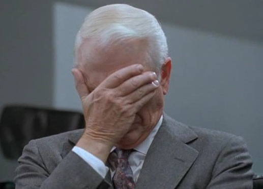

It is December, and after a board meeting the Chief Executive Officer
(CEO) calls the Chief Technology Officer (CTO) into his office. The CEO has
reported that this year the company billed 120 million dollars.
Intrigued, a board member asks what the **average monthly
revenue** was. Since the report did not include that figure, the CEO tasks the CTO
with working on it, so that next year's report will include this
**new indicator**.

Back in his office, the CTO calls in the Deputy Manager of Development (DMD)
and asks him to implement an application that calculates the
**company's average monthly revenue indicator**. The DMD, who
regards himself as a very intelligent person, asks, "And why
does it have to be monthly, when we could make it parametric?" The CTO looks at him
in amazement. "Brilliant!" he exclaims, and they call a meeting with the Project
Manager (PM).

The PM takes note of the requirement to implement the **Senior
Management Information System** (SMIS). The PM, who is a very
proactive and organized person, opens a folder in the document management
system (dmd, in lowercase so as not to confuse it with the DMD) and
immediately creates the project's first Gantt chart. He ends the day
by calling a meeting with the analysts on his team.

After the year-end holidays, the PM meets with the analysts and
lays out the primary and secondary objectives of the SMIS. One
analyst volunteers to work on the non-functional requirements and
disappears for two months. The other two systems analysts call
a meeting with the users from operations, to gather
their specific requirements.

The users from Operations (OPS) are delighted, because
"finally, after 3 years, those technology guys are going to
build us the system we need". After 3 weeks of long
meetings, the analysts have a document summarizing 367
new requirements, 167 improvements and 89 unresolved bugs.

With this document the PM prepares a pre-feasibility report,
suggesting that the bugs and improvements be postponed and the requirements cut to
100 so the project can ship within the year.

Three weeks later, back from vacation, the PM meets with
the DMD. They download the pre-feasibility report and the updated Gantt
chart from the dmd. The DMD nearly faints when he reviews the spreadsheet
with the number of man-hours involved, adjusts the numbers,
congratulates his PM and schedules a meeting two weeks out with
the CTO to review **the project's progress**.

The CTO finally has a **preliminary figure**, and presents it at the
management coordination meeting. The Chief Financial
Officer (CFO) asks about the budget for this project. The CTO
answers that this is a project that directly benefits the CFO's area,
because it has to do with the earnings report to the board. Faced with
such a solid argument, it is decided to redirect a couple of line items from
the OPS investment budget to fund the project. This is
possible because the head of OPS is not at the meeting that day; he is "putting out
a fire".

Finally the CTO talks to the DMD and tells him to go ahead with the
tender, but notes that they have been talking to the
wrong users and should be talking to the finance people. The
DMD writes down the observation and passes it on to the PM; while they are at it, they
classify the project as **critical** to the company.

Two months later, after long and exhausting meetings with the finance
users, the team of systems analysts has produced a
project scope document. The non-functional
requirements analyst (NFA) disappears again for three more months, because he
had not been told about the changes or the project's new critical
classification, and he needs to modify the documentation.

With all this documentation in hand, the PM and the DMD draw up the request
for proposals. While they are at it, they talk to the Deputy Manager of Systems
(DMS) about the project. The DMS complains that nobody ever tells him anything,
and that if they had let him know earlier he would have been able to put the
infrastructure out to tender before the first quarter closed, which would have
earned juicy discounts from the international vendors. The
DMS asks about the non-functional requirements and the project's
hardware needs. It is agreed that the DMS will track down the
NFA and work on _sizing_ the storage for a system with
1 year of data online, plus backups for 5 more years.

The tender process begins. Since it is already May, the
vendors are asked to submit their proposals in the shortest possible
time. Ten companies take part, and 687 questions are raised. 87% of
the questions were answered in the RFP, of course, and the other 13% do not
apply.

The tender is won by a company chosen for offering an
agile development methodology.

The kickoff meeting is scheduled for the first week of June. The
non-functional requirements are expected before then, because
the vendor is very concerned about this point. Nobody knows where the
NFA is; he is suspected of having accrued vacation days.

The kickoff meeting is a success. The vendor takes the opportunity to
clarify that they implement a methodology that could be described
as a *modified Scrum-Ban*. Nobody quite understands what that
means, but everyone leaves the meeting happy, because we will have a
backlog in 2 weeks.

A month later, when the PM asks the vendor for the Use Cases
(UC), he learns that development is stopped because the
purchase order has not been issued. The impasse is settled over lunch, and the
project resumes. At the coordination meeting it is reported that the project
is 50% complete. The DMS insists that he still does not have the
non-functional requirements and therefore cannot size the
infrastructure. The NFA is still missing.

After the use cases are reviewed and then approved, at
the end of August, the first prototypes are expected to be delivered
after the national holidays in September, which is good because the QA team
frees up around then. It is decided to replan the
project to reflect these agreements.

In September, the vendor's lead programmer suffers a nervous
breakdown from not having the non-functional requirements. At the coordination
meeting it is reported that the project needs to be rescheduled,
but that despite the delays it has advanced another 48%, and the remaining
52% can be made up with an internal reassignment of the vendor's
resources. The vendor has stated that although it is losing
money on the project, it will absorb the cost of this
rescheduling anyway. It is decided to pay the invoice that had been withheld for the
use case delivery milestone (after all, only 1 UC is missing, the one
for a*\* report that gives some monthly revenue
averages*\*, so it is a minor thing).

Finally, a deployment is done to the integration environment. There were
problems setting up the VPN, but the vendor is able to deliver
the product in mid-October, as expected. All that is left is QA and
**going to production.**

After a hard-fought go-live, and just in time to
deliver the indicator before the December board meeting, it is
discovered that the year to be calculated is hard-coded.
The vendor insists that a change request is required, because it
was never specified that this part should be parametric.

In the end an operations analyst working for the head of Operations ends up
calculating the average monthly revenue in an Excel spreadsheet. The
NFA finally delivers the non-functional requirements document, and it
turns out the storage is undersized.

The Auditor reports that the new SMIS meets the highest
standards and has allowed the company's risk rating to improve.

A Gartner study predicts that by 2014 the reading and spreading of
this text will cause losses of 6 trillion dollars a year in IT
departments. Curiously, Chile's GDP will not be affected.

The events described are fictitious. Any resemblance to reality
is pure coincidence.

