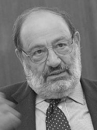

Today the newspaper El País published this [polytheistic dialogue](http://www.elpais.com/articulo/portada/Dialogo/politeista/elpepuculbab/20110122elpbabpor_9/Tes)
between Umberto Eco and Javier Marías. It must have been a fascinating
encounter between these two old thinkers. Talking about the internet was
inevitable:

>**Umberto Eco.** The Internet is the return of Gutenberg. If McLuhan were alive
> he would have to change his theories. With the Internet it is an
> alphabetic civilization. They will write badly, they will read in a hurry, but if they don't know the
> alphabet they are left out. Today's parents watched television, they didn't
> read, but their children have to read on the Internet, and quickly. It is
> a new phenomenon.
>
> **Javier  Marías.** That would be an advantage.
>
> **U. Eco.** It is the positive side.

That reminds me of [Clay Shirky's idea of cognitive surplus](/en/blog/lnds/2008/05/28/gin-television-and-social-surplus/):
television is the great time sink for a lot of people, but the internet
has the potential to generate more participation, and so,
in a sense, it is a new round of literacy. Gutenberg
is not dead, he has only changed his medium. The use of written
language is different, but it is inevitable that language evolves:

> **J. Marías.** But what we were saying about language, about the
> widespread use of the computer\...
>
> **U. Eco.** That is another problem, it has nothing to do with it. I don't think
> language is getting poorer, it changes! English is a
> syntactically very poor language compared with French, Italian or
> Spanish; but it can say wonderful things. So it
> gets simpler, but it can say many things. Languages work.

But the reflection I find most interesting in the whole text is
this one:

> **J. Marías.** Sometimes I have the feeling that general exhibitionism
> is omnipresent in these forms of communication. On the Internet, for
> example, if you set up a camera you can watch a room at all hours;
> there are people who stay in contact to watch each other sleep or
> cook, which would not be much of a show\... Sometimes I have
> the feeling that this bears some relation to the gradual
> loss of that old idea, one that accompanied mankind
> for centuries, that God saw everything, that God watched
> everyone and that absolutely NOTHING escaped his gaze and scrutiny. In
> a way, that idea, which some of those who
> read *L\'Osservatore* still hold, was something terrible, but it was also a comfort,
> since there was a spectator who knew our life. Even if you were the
> least important person in the world, there was someone\...
>
> **U. Eco.** A gentleman who paid for a ticket to watch you and then
> judge you!
>
> **J. Marías.** He punished or rewarded you. At least you existed for
> someone. And that belief, obviously, speaking in general terms,
> has been lost. I think part of the population,
> unconsciously, is nostalgic for that idea. There was an enormous need
> to be contemplated, to be observed.
>
> **U. Eco.** Today they go on television or the Internet.
>
> **J. Marías.** Yes\... It answers that old nostalgia for the idea of
> God.
>
> **U. Eco.** Interesting. Otherwise there is no explaining how they have this
> tremendous need to be seen, even when they are on the toilet. And I say:
> why?

Interesting. Is it nostalgia for being watched by a god that
drives young people to exhibitionism? At least today you know who is
watching you. We all want to be valued, observed, appreciated by
someone. To exist for someone\...

That explanation is ingenious. It is an unconscious motivator, impossible to
prove, and like all numinous explanations it has the charm of being
irrefutable. But this generation's need to be seen has
[future consequences](/en/blog/lnds/2009/02/04/digital-tattoos/), and
that is what needs a warning.

> **J. Marías.** People now say, instead of "I want to tell you",
> "I want to share this experience with you", or "I want to share with you
> this experience", instead of "I want to tell you". The aim is to
> involve others.
>
> **U. Eco.** A phrase no longer in use is: "As God is my
> witness"; at least he knows that this is how I am. Now it is "as
> television is my witness, the community". There is an Italian comedy where
> your name is private property, you must not spread it around. And there is the
> saying that dirty laundry is washed at home. Privacy,
> keeping everything hidden, used to be fundamental. Today it is the exact
> opposite. And worse things. I don't know the reason for that need to be
> seen or to feed like vampires on other people's lives. The explanation about nostalgia
> for God is the most logical one.

And a reflection on what happened with
[Wikileaks](/en/blog/lnds/2010/12/04/illegal-activities/)
is inevitable, as inevitable as questioning the demand that everything must
be transparent:

> **J. Marías.** There is one element that also has to do with all
> this: the Wikileaks leaks. There is something strange and amusing
>
> \... Normally we are forbidden to know things, especially about
> powerful people or people with responsibilities, and seeing them ridiculed, the
> emperor with no clothes, or seeing them put their foot in it, that is understandable. What I don't understand
> is that after this little phenomenon there are people calling for
> transparency: "Enough. We have to know everything. We have to know
> what the secret services do, what the diplomats do, what they think".
> But careful! Hypocrisy, duplicity, is part of good manners;
> more than that, of civilization. If there were general transparency
> there would be many more homicides. All of us speak ill of
> everyone from time to time, when they are not present, including the people we
> love. There are always objections. Probably if the people
> we love knew what our objections are, they would forget
> all the good things we think of them and become obsessed with that
> small objection they found out about and should never have known, and
> it would be a disaster.
>
> **U. Eco.** Diplomatic measures are at the root of
> civil coexistence.
>
> **J. Marías.** It is a matter of civilization, it is an achievement.
>
> **U. Eco.** I don't say: "I'm not having dinner with you because you are
> boring". I say: "I can't come because I have an engagement".
>
> **J. Marías.** So calling for general transparency is also
> something that would go against everyone's interests. Because if everything
> were like that, people would be fired more easily. We have this
> tendency, this need to vent. It is normal that there are people who try
> to find out what should not be known, but it is also normal that others
> try to keep things from being known. What is ridiculous is the demand
> by certain people that those whose duty is to keep
> things from being known should give up that duty. What you cannot do is ask for the
> total surrender of everyone else. And with Wikileaks I am surprised that
> nothing more brutal was said, or nothing we did not already suspect. They are
> restrained, polite diplomats. I find it amusing\... It is strange,
> this demand; I don't understand this urge to know everything.
>
> **U. Eco.** Yes, yes. And with this breaking of the pact of hypocrisy, which is
> a fundamental social pact ("delighted to meet you"; I am not
> delighted, but it has to be said), we have entered a new virtual
> era of information where everything is more vulnerable and fragile. In
> the end we will have to find other forms of confidentiality. What
> will they be? We don't know. With the Internet no censorship is possible any more.
> Look at Julian Assange: he should be flushed down the toilet, or thrown in the trash, but
> everyone found out what he did. Someone once said that if
> the Internet had existed the Holocaust would not have been possible, because
> nobody could have said: "I didn't know". In China they have not accepted the
> Nobel Peace Prize, but in China plenty of people found out about it. What
> is taking shape, and I wrote this years ago, is a new \_1984 \_with
> a ruling class that has access to the Internet and proletarians who
> have no access, who watch television. What future are we
> heading toward? Will there be more proletarians or more of the computerized class? Because if
> a computer cost ten euros, maybe one billion two hundred million
> Chinese would have one, and then there would be fewer proletarians than
> computerized people. And censorship could no longer work. But if
> a proportion like the current one holds, it will be the exact opposite;
> censorship can go on.
>
> **J. Marías.** If the rules are torn up and transparency spreads,
> citizens will probably always be on the losing end, since the
> possibility of governments intruding into their lives is
> much greater than the reverse. That is the danger I see in
> legitimizing the idea that everything should be known\...

Does everything have to be known? Privacy no longer exists, Gutenberg has been
surpassed, the idea of beauty, style, aesthetics are all anachronistic
ideas that only matter to two old writers talking in
Madrid, right? ;)
