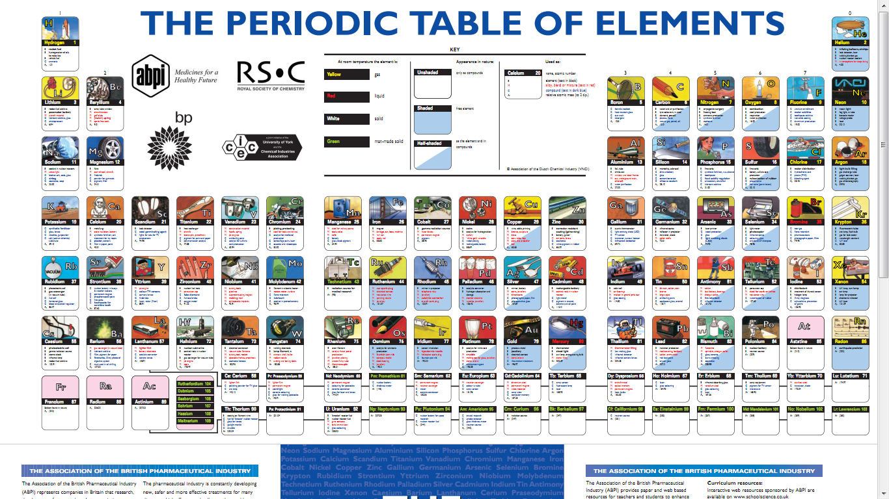
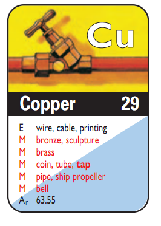
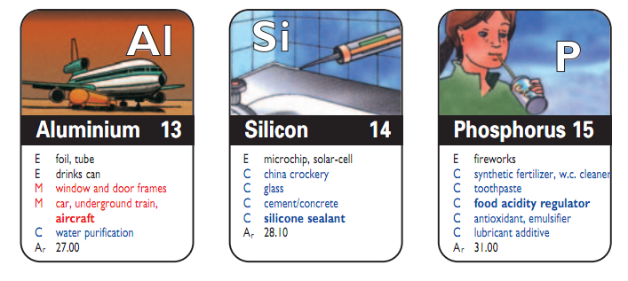

Here is something I didn't know about, and it has been published since 2005:
a periodic table of the elements organized around their
applications.

The idea is to put in each cell of the table an illustration
showing everyday objects where that chemical element
is used:

For example, here is Copper (Cu):

And here are Aluminum (Al), Silicon (Si) and Phosphorus (P):

The table is available for free. You can download it
from [here](http://www.abpi.org.uk/publications/pdfs/Periodic-table-2005.pdf).
It was published by the British chemical and pharmaceutical industry, and
the sponsors include British Petroleum (ouch).

In any case I think it is a brilliant way to spread
knowledge. It would be great to have a visualization like this in our
language, don't you think?
