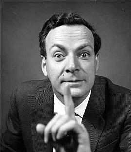

What is energy? Ask any educated adult around you, and write down the
answers. Even someone with a scientific background may not have a very
clear one. It is the capacity to do work, would be the most formal
answer you are likely to get.

The question is far from idle, because after all, important decisions
are being debated right now, such as how to keep our country's energy
matrix supplied. Whether we should invest in nuclear plants, or whether
we should use non-conventional renewable forms of energy. And when I
hear that pompous term I wonder whether the people who came up with it
have any idea what the hell energy is, given that they need to tack on
the inadequate and redundant adjective "renewable".

The problem is probably our education, because it has to be said: if
math and reading education is already bad, imagine what happens with
science. And the bad part is that people defend positions with inexact,
deficient concepts. The arguments are often medieval, lifted from some
old treatise on necromancy or some alchemy manual, and have little to
do with reality as modern science understands it. And if these
fundamental concepts are wrong, can we expect the decisions being made
to be the right ones?

I hope the following text by Richard Feynman helps make my point a
little better.

> "\...There is a first grade science book which, in the first lesson
> of the first grade, begins in an unfortunate manner to teach science,
> because it starts off on the wrong idea of what science is. There is a
> picture of a dog--a windable toy dog--and a hand comes to the winder,
> and then the dog is able to move. Under the last picture, it says
> "What makes it move?" Later on, there is a picture of a real dog and
> the question, "What makes it move?" Then there is a picture of a
> motorbike and the question, "What makes it move?" and so on. I thought
> at first they were getting ready to tell what science was going to be
> about--physics, biology, chemistry--but that wasn't it. The answer was
> in the teacher's edition of the book: the answer I was trying to learn
> is that "energy makes it move."

> **Now, energy is a very subtle concept. It is very, very difficult to
> get right.** What I meant is that it is not easy to understand energy
> well enough to use it right, so that you can deduce something
> correctly using the energy idea--it is beyond the first grade. It
> would be equally well to say that "God makes it move," or "spirit
> makes it move," or "movability makes it move." (In fact, one could
> equally well say "energy makes it stop.")

Look at it this way: that's only the definition of energy; it should be
reversed. **We might say when something can move that it has energy in
it, but not what makes it move is energy. This is a very subtle
difference.** It's the same with this inertia proposition. Perhaps I
can make the difference a little clearer this way: If you ask a child
what makes the toy dog move, you should think about what an ordinary
human being would answer. The answer is that you wound up the spring;
it tries to unwind and pushes the gear around. What a good way to begin
a science course! Take apart the toy; see how it works. See the
cleverness of the gears; see the ratchets. Learn something about the
toy, the way the toy is put together, the ingenuity of people devising
the ratchets and other things. That's good. The question is fine. The
answer is a little unfortunate, because what they were trying to do is
teach a definition of what is energy. But nothing whatever is learned.
Suppose a student would say, "I don't think energy makes it move."
Where does the discussion go from there?

I think for lesson number one, to learn a mystic formula for answering
questions is very bad. The book has some others: "gravity makes it
fall;" "the soles of your shoes wear out because of friction." \... To
simply say it is because of friction, is sad, because it's not science.

> My father dealt a little bit with energy and used the term after I
> got a little bit of the idea about it. What he would have done I
> know, because he did in fact essentially the same thing--though not
> the same example of the toy dog. He would say, "It moves because the
> sun is shining," if he wanted to give the same lesson.
> I would say, "No. What has that to do with the sun shining? It moved
> because I wound up the springs." "And why, my friend, are you able to
> move to wind up the spring?"
>
> "I eat."
>
> "What, my friend, do you eat?"
>
> "I eat plants."
>
> "And how do they grow?" "They grow because the sun is shining."
>
> And it is the same with the [real] dog. What about gasoline?
Accumulated energy of the sun, which is captured by plants and
preserved in the ground. Other examples all end with the sun. And so
the same idea about the world that our textbook is driving at is
phrased in a very exciting way. All the things that we see that are
moving, are moving because the sun is shining.
>
> It does explain the relationship of one source of energy to another,
and it can be denied by the child. He could say, "I don't think it is
on account of the sun shining," and you can start a discussion. So
there is a difference. (Later I could challenge him with the tides, and
what makes the earth turn, and have my hand on mystery again.)"

The text this fragment comes from is called "What is Science?", and
there is [a copy at UNAM](https://www.cneq.unam.mx/cursos_diplomados/diplomados/medio_superior/SEIEM/1a/02/00/02_material/01_tacuba/03_cono_fis/archivos/QUE%20ES%20CIENCIA.pdf).
The text is about education, and also about energy. Because what we
need to do is educate people, so they understand what we are talking
about when we talk about energy, because it matters, because it affects
them. Education is the key, and it could spare us disasters, both
energy-related and ecological.

I think we have to start by understanding what we are talking about. It
is not enough to say the country needs more energy if we are not clear
on what this thing we call energy is.

If energy is neither created nor destroyed, isn't it a bit ridiculous
to ask for it to be renewable? And what does that principle that energy
is not destroyed actually mean? Then why is there an energy shortage?
Is there really an energy shortage? Where does global warming come
from, and what does it have to do with energy? Do I really save energy
if I unplug the TV? Can energy be saved?

If we do not understand [the subtlety of the concept of energy](https://www.amazon.com/gp/product/B0041OTADO?ie=UTF8&tag=lanaturaledel-20&linkCode=as2&camp=1789&creative=9325&creativeASIN=B0041OTADO),
how can we be sure our ideas about its use, or about the ways of
generating it, are the right ones? What are the consequences of our
decisions about something we do not understand? Do the people debating
these issues understand what they are talking about? Do the people who
decide to build or not build power plants understand what they are
doing? I have my doubts\...
