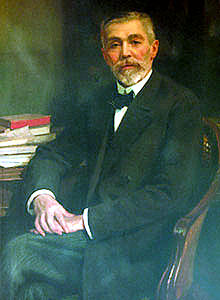

They say that before he died the Sugar King thought of a story about
Confucius and decided to leave his entire fortune to educate the
poorest people of his country. The tale was recorded in the papers he
left behind, and "told the story of a charitable traveler who took
pity on the poverty of the inhabitants of an island and gave them fish.
Seeing this gesture, the Chinese philosopher said he had done wrong,
because with his gift they would eat for a day, but had he taught them
to fish they would have food every day."

The story goes that as a teenager the Sugar King met the French
merchant Louis Le Quelleq. What surprised the businessman was the
teenager's claim that "if I had twenty thousand pesos I would invest
them in shares of the Compañía Sudamericana de Vapores. Within a month
I could return that sum and have my own capital". The businessman
trusted the young man and lent him the money. When the Frenchman
returned to Valparaíso, he got his money back, with interest.

The boy in the anecdote was Federico Santa María. A brilliant stock
market speculator. After making his fortune in Chile he leaves for
France in 1894. He settles into an austere apartment in Paris and from
there starts building his stock market empire. In time he comes to
control the price of essential goods. So much so that he is called out
by the press and by the French Chamber of Deputies. He is accused of
"attacking the French people", he is branded "the enemy of all Europe"
and "Satan", and there are calls to have him expelled from France.

Joaquín Edwards Bello would write: "In this respect, don Federico Santa
María appeared bearing the biblical lightning of an avenger: a son of
Valparaíso, the city that watched so many enriched and ungrateful
foreigners leave\... He managed to embed himself in the heart of Europe
to take a part of it back".

He was stingy and antisocial. French high society wanted to rub elbows
with him, but he refused to attend the dinners and events he was
invited to. He would later regret it, because he never managed to marry
and have children.

All of a sudden he took to sugar. He thought that this way he was
helping the Chilean nitrate industry, since the beet growers needed
nitrate. The European sugar refiners fall one by one. In April 1910 the
French deputy Georges Berry asks about the unjustified rise in the
price of sugar, which made no sense given that the 1909 world harvest
was larger than that of 1908. The answer was: "ask the Chilean Santa
María".

"It is unacceptable that a single speculator\... can dictate his
prices to 39 million consumers". A lawsuit is brought against him. He
is asked to hand over the figures for his stocks: "I cannot give the
figure for those in Paris, nor those in Hamburg, nor London, nor
Amsterdam, because the interests are too great for me to risk giving my
competitors information in a fight that is still going on, competitors
who do not come forward, hoping to corner me into a forced sale at a
low price."

The case is dismissed, because the isolated speculation of a merchant
who merely buys when prices are low and resells when they are high,
even if it covers all or most of the merchandise, is not considered
hoarding in the legal sense.

When the First World War begins he decides to retire from business,
because he does not intend to speculate on the conflict. But he worries
about the fate of France and the Allies. The man had a heart. In fact,
he once canceled an order when he learned it could ruin Le Quelleq, the
merchant who had lent him the twenty thousand pesos in his youth.

Years later it came out that Santa María had acquired a considerable
quantity of war bonds, and that when the conflict ended he handed them
over to the French government to support the reconstruction of the
country that had taken him in.

And he goes back to business in 1923, at 78, and "to see if my head
still works", he makes his biggest stock market gain: 200 million
francs in one day. Two years later, in 1925, don Federico Santa María
dies, but he leaves his [famous will](http://www.inf.utfsm.cl/~contrera/competencias/documentos/testamentoFSMC.pdf),
which sets out the requirements for founding a university for
Valparaíso:

> "I wish, above all, to tell my fellow citizens that I devoted the
> last thirty years of my life exclusively to altruism, and to that
> end I made my first will in eighteen ninety-four, bequeathing a
> University to the city of Valparaíso; but, over the course of time,
> experience showed me that this was a mistake and that it was of
> capital importance to raise up the proletarian of my homeland,
> conceiving a plan by which I contribute my mite first to childhood,
> second to the primary school, from there to the School of Arts and
> Trades and lastly to the College of Engineers, putting within reach
> of the deserving poor the attainment of the highest degree of human
> knowledge; it is the duty of the wealthy classes to contribute to
> the intellectual development of the proletariat."

> "I leave to my executors the whole of my estate, once the
> bequests and debts have been satisfied, so that they may apply said
> estate or its proceeds to the creation and establishment in the city
> of Valparaíso of the following institutions: A

> SCHOOL OF ARTS AND TRADES, with boarding and day sections; only
> students who have distinguished themselves in the primary schools
> for their intelligence and diligence shall be admitted as boarders;
> likewise, two or more students shall be admitted, at the discretion
> of the Board of the Institutions, for each province of Chile, who
> have also distinguished themselves in the schools of those provinces;
> instruction, as well as lodging, food and clothing, shall be free;
> in addition, in the school's boarding section there shall be separate
> rooms for the students who have in turn distinguished themselves at
> the School of Arts and Trades, and who by their aptitudes the Council
> considers deserving of continuing their studies and moving on to the
> College of Engineers; in no case shall the children of wealthy
> relatives be admitted as boarders at the School or the College, but
> they may enroll as day students at both establishments; admission to
> the day section shall be as determined by the supreme board of the
> institutions. A COLLEGE OF ENGINEERS, in all its branches, civil,
> railways, factories, mining, hydraulics, electricity, etc., etc., and
> all those other branches that physical progress may establish; the
> boarding section of this college shall be that of the School of Arts
> and Trades, as stated above, and it shall be open only to those whom
> the Council considers fit to pursue their studies, whether they come
> from the School of Arts and Trades or from other schools, and who
> lack the means to pursue them; there shall also be a day section for
> students in general, in which the Council shall determine whether
> those attending are fit to pursue a career as engineers. The day
> students of both the School of Arts and Trades and the College of
> Engineers shall be served the same meal the boarders have at
> lunchtime. These institutions being, in their instruction,
> essentially secular, all religious instruction is hereby prohibited
> within the schools, and must be given by the students' relatives at
> home. Both the School of Arts and Trades and the College of
> Engineers, and any other institution that may be created later, must
> add to their title the name of JOSÉ MIGUEL CARRERA, in homage to the
> great patriot who gave the first cry of independence in Chile and as
> a lesson to the students that they owe themselves, above all, to
> their homeland. "

That is the origin of the Universidad Técnica Federico Santa María.
Santa María had no children, and it is said that he was once asked what
he would have done with a son if he had had one: "At 18 I would have
thrown him out on the street to earn a living".

That is the legacy of the Sugar King, a man who made an impact
worldwide: a speculator, an avenger according to others, an altruist, a
philanthropist at the end of his days. A human being, a Chilean who in
the end closed the best deal of all, devoting his fortune to the
education of his countrymen and to lifting them out of poverty. This is
the story I hope every young person, and everyone educated at that
university, comes to know and passes on. Here's to you.

The quotes are from the book "Para Saber y Contar" by Hernán Millas,
published by Planeta, 2010. The image is from [this
article](http://en.wikipedia.org/wiki/Federico_Santa_Mar%C3%ADa) on
Wikipedia
