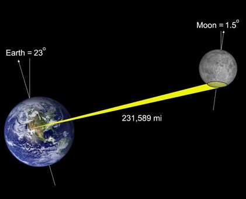
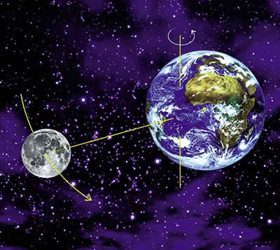
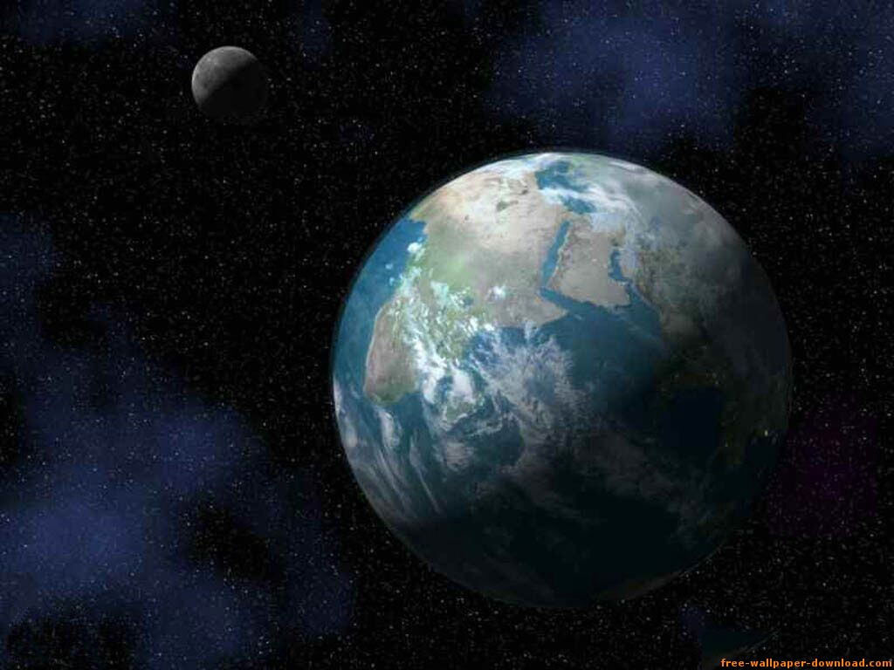

This video is interesting because it shows an estimation error that
seems to be quite common, and that may have its origin in the education
we receive.



In the video people are handed 2 balls and asked to represent the
relative distance between the Earth and the Moon.

(via [En Resumidas Cuentas](http://eduardoe.tumblr.com/post/3457865131/la-luna-no-esta-tan-cerca),
[amazing.es](http://amazings.es/2011/02/23/la-luna-no-esta-tan-cerca/) and
above all [Recuerdos de Pandora](http://recuerdosdepandora.com/ciencia/astronomia/distancia-entre-la-tierra-la-luna/))

The diameter of the Earth (which [can be calculated with a simple experiment](http://web.educastur.princast.es/proyectos/fisquiweb/AIA/eratostenes.htm))
is approximately 12,700 kilometers.

There is roughly one light-second between the Earth and the Moon (light
takes one second to arrive from the surface of the Earth). Since the
[speed of light](http://es.wikipedia.org/wiki/Velocidad_de_la_luz)
is 300,000 kilometers/second, that gives us a distance between Earth
and Moon of about 24 Earth diameters.

Basketballs have a diameter of 24 centimeters, so the distance between
the representations of the Earth and the Moon would be 5.76 meters.
That is 7 or 8 steps, depending on the person's height (the presenter
takes 10 steps).

Some illustrations of the Earth-Moon distance that lead to this
mistake:

