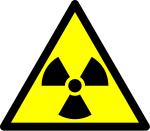

These days there has been a lot of news about the nuclear accident in
Japan that mentions certain radiation measurements. For example, at one
point a peak above 8,227 microsieverts was measured at the plant, and
the limit is 500 microsieverts.

But what does that mean? The news tells us that doses thousands or
millions of times higher than allowed were emitted, without explaining
what those limits are or what they mean for health. And even though the
explanation is within everyone's reach, the media seem too lazy to
investigate and explain, or maybe there is no interest in putting
things in
[perspective](/en/blog/lnds/2011/01/02/perspective/)
(thinking like a conspiracy nut, maybe keeping the public alarmed is
good business for someone).

A [Sievert](http://en.wikipedia.org/wiki/Sievert) (Sv) measures the
radiation dose absorbed by tissue. It is obtained by measuring the
energy absorbed per kilogram of weight (expressed in
[Grays](http://en.wikipedia.org/wiki/Gray_(unit))) and multiplying it by
a factor that depends on the radiation source.

For reference: a chest X-ray exposes you to 0.04 mSv, a mammogram is
0.3 mSv, a chest CT scan runs between 6 and 18 mSv. The natural
radiation of the human body is 0.4 mSv/year.\
If I'm reading this right, a dose of 8,227 µSv/hour, or 8.23 mSv, is
equivalent to 197.45 mSv in 24 hours. Why do I express it in 24 hours?
To compare it with the table further down.   ~~the dose of 8,227
µSv/hour would mean that if you are exposed to the Fukushima reactor
for one hour you receive the equivalent of a chest CT scan.~~

A person only starts to be affected above 0.25 Sv (250 mSv, or 250,000
µSv), that is, the highest dose measured so far at Fukushima is ~~one
third~~ roughly 4/5 of the dose that starts to cause nausea.

By the way, the Japanese plan ahead and set the legal radiation limit
for their plants at 500 µSv/hour, that is, 1/50th of the radiation that
starts to cause nausea.

According to Wikipedia the damage is described in this table (for one
day of exposure)

-   0--0.25 Sv: Nothing

-   0.25--1 Sv: Some people feel nausea, loss of appetite, damage to
    bone marrow, lymph nodes and spleen.

-   1--3 Sv: More severe nausea, loss of appetite, infection, more
    severe damage to bone marrow and lymph nodes. Recovery is likely,
    though not assured.

-   3--6 Sv: Severe nausea, loss of appetite, hemorrhaging, infections,
    diarrhea, peeling skin, sterility, death if untreated.

-   6--10 Sv: All of the above symptoms, plus deterioration of the
    central nervous system, death expected.

-   Above 10 Sv: Incapacitation and death.

The 8,227 µSv/hour radiation at Fukushima is still below the lowest
threshold in this table.

**Update:** as Javier Rovegno points out, the effects of radiation are
"cumulative" (if you damage an organ through prolonged or intense
exposure you do not recover). The situation is serious, which is why
people are being evacuated while the leaks are contained. After that
they have to make sure no waste and no radiation sources are left in
the environment, which is quite hard.

We know radioisotopes have escaped into the atmosphere, and some will
remain for decades; it would be interesting to know how much and of
what kind. The important thing now is to contain the radiation sources,
which is what the Japanese engineers are doing. Let's hope they succeed
and the situation does not get worse.

**Second update**: unfortunately, right now there is a discrepancy
between the Japanese authorities and the international ones about the
severity of the catastrophe, between 4 and 6 on the [INES scale](http://es.wikipedia.org/wiki/Escala_Internacional_de_Accidentes_Nucleares).
This adds another degree of uncertainty to the information, and with it
more alarm.

**Third update:** I corrected some calculation errors.
