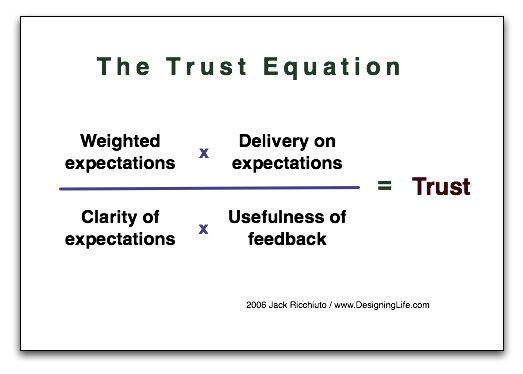

Direct interaction with the user, building trust, anarchy: the keys to
this talk by [Fred George](http://www.infoq.com/author/Fred-George) on
infoq, which I recommend: <http://www.infoq.com/presentations/Leaner-Programmer-Anarchy>

For entirely accidental reasons, I am in the middle of a process of
anarchy with one of my teams. There is no "project manager" in charge
of this team of 4 developers. Right now they report directly to me, but
they are literally working without a manager.

We commit many of the heresies Fred George proposes, and not because we
are ultra-modern and experimenting with lean or post-agile
methodologies. We simply have to get the work done. And the interesting
part: I have observed that trust in this team's ability has gone up,
mainly among our internal customers.

Here is a short description of what we are doing:

-   There are no sprints and no kanban board, but we use Jira to record
    what we have to do and to know who is on what. There are no standup
    meetings, no user stories, no estimates, not even coordination
    meetings.

-   They make their own decisions, they are autonomous, they keep me
    informed, but there are no bureaucratic barriers. They come to me
    to unblock whatever is keeping the work from getting done. My role
    is to facilitate and to get the other areas to commit so we can
    meet our deliveries.

-   The only significant bureaucratic barrier is in the releases to
    production.

-   The concept of QA is fuzzy. There is no QA team; the end user tests
    the new features on the development environment and gives immediate
    feedback. Going through the QA environment is almost a formality, a
    step to bring the environments in line (which calls a lot of the
    internal procedures into question, but I have decided to put that
    fight off).

-   We increased the interaction between end user and developer. The
    developers spend a lot of time sitting with the user studying the
    problem and proposing solutions that even the user had not
    envisioned.

-   The developer is: functional analyst, architect, designer and
    programmer.

-   Date commitments: we deliver when we commit to.

-   [Worse is better](/en/blog/lnds/2014/01/25/garbage-collection/): what gets
    delivered is usually less than 100%, but it is usable.

We have managed to increase trust, and that is what has surprised me
most. The users feel they are finally getting applications that are
closer to what they needed.

An example: an application's spec said it had to "upload files by means
of a button". The implementation, which had been in production for more
than a year, did that, but it only allowed uploading one file at a
time, and while the file was uploading the user was unable to do
anything else. What the users actually needed was to schedule a series
of multiple uploads. The developer, by sitting down with the users and
watching what they did, understood the serious usability problem of the
application as it stood. The result was that in the next release he
brought them, as a surprise, an improved interface that left the user
free to do other things with the computer (the user never asked for
that improvement; it was offered "for free" by the developer).

The big problem with the heavier methodologies is that between user and
developer there are many barriers: End User -\> Boss -\> Stakeholder
-\> Sponsor -\> Project Manager -\> Functional Analyst -\> Designer -\>
Architect -\> Programmer.



The interaction should be End User \<-\> Developer. That improves
understanding, the communication of the problem, and trust. In the end,
this interaction emerges: End User \<- Developer; it is the developer
who ends up offering new features to the end user.

Things I like about Fred George's presentation, and that in a way I
have conveyed on this blog:

1.  We need results, not explanations, and not a hunt for someone to
    blame. This thinking eliminates estimates, retrospectives,
    iterations, and all that "waste" that agile methodologies end up
    generating.

2.  Standup meetings and stories can be replaced with more interaction
    with the user.

3.  Fewer roles. Collapse all those functions into a single one:
    developer. Even the manager disappears. In the end what we need is
    to hire good programmers.



The value of building trust between the developer and the user is, in
the end, the great lesson of this experience, and what Fred George gets
across in his talk. Once again I invite you to watch it, to study his
heresies, and to put them into practice.

A cynical reader could criticize me and say that I am not really
managing, and that this anarchy will end up costing me. The truth is I
never planned to follow this strategy; I have always worked this way
:). I am a committed anarchist, and my experience has shown me that
plenty of projects can be carried through like this. What happens is
that people get nervous when there is no structure, planning and all
that, especially engineers, who are the most nervous of all. Don't
worry so much, and trust.

