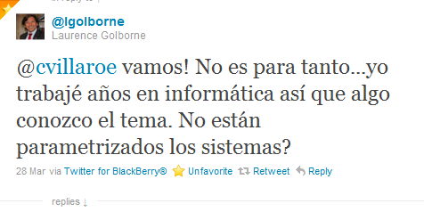
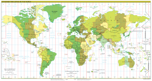

Right now in Chile, setting up a meeting, with technology of course, is
[chaos](http://www.theregister.co.uk/2011/03/29/chilean_clocks/).

A friend and I arrange a lunch meeting for 13:00. He sends the invitation
for 13:00 from his Android phone, synced with Google Calendar. Through an
intricate web of transactions it reaches my company, which runs Microsoft
Exchange, and from there, through a
[BES server](http://en.wikipedia.org/wiki/BlackBerry_Enterprise_Server), my
Blackberry. The result of all this interoperability choreography?
On my phone's calendar the meeting is set for 14:00, in Outlook on my
office PC for 13:00, and the oddest part is that, for some reason, my
friend gets an automatic email confirming that the meeting has been
accepted and scheduled for 17:00!!

I don't know what time zone my colleague has configured on his Android, but
I had to set my Blackberry to the Montevideo zone to get things to work
reasonably well. I have no idea how the Exchange servers are set, or the
BES. What I do know is that
[Google leaves the problem to the user](http://googleamericalatinablog.blogspot.com/2011/03/google-calendar-y-el-horario-de-chile_29.html)
(so much for cloud computing). That everybody is coordinating by phone or
putting the time in "out-of-band messages". That
[Microsoft states](http://blogs.technet.com/b/latam/archive/2011/03/29/updated-chile-dst-changes-2011.aspx)
that there is no time to roll out a patch that would be transparent to
users.

And the minister says this is no big deal, that it's just a matter of
changing some parameter, because you IT people are smart and have
everything parameterized, right? Charming, the minister.

But it isn't quite like that. The problem is not just calendars and
meetings out of sync.

-   There are still plenty of computers that haven't been updated, because
    there was no time to apply the patches to thousands of servers. Well,
    now there is a bit of time, how nice, let's see if those sysadmins
    finally finish.

-   Many users still don't know what to do with their phones and personal
    computers. They'll have that problem until May, and they'll have
    problems again in August.

-   Time clock systems that are recording overtime, or late arrivals. I
    suppose the people in human resources will be delighted reconciling it
    all at the end of the month (and the developers of those systems even
    more so, at least they'll bill the overtime to "fix the system" :)

-   Air traffic control, transportation and telecommunications systems.

-   Processes that had to be reconfigured because they depend on certain
    hours to run. Here it really is likely that parameters have to be
    changed, but somebody has to do that job, and multiplied by thousands
    of servers we get a lot of valuable man-hours spent on unnecessary
    work.

-   Transaction timestamping (and what about transactions that interoperate
    with systems outside our country?)

-   Cloud applications hosted in other countries that assume our time zone
    behaves the way it was established.

-   If some clever sysadmin had scheduled a script so his servers would
    adjust their clocks this weekend, well, you know what he's busy with.

-   The worst part is that we'll have to repeat this whole annoying
    exercise in August.

**Update**: To be clear, the main problem is one of infrastructure and
operations, not of badly designed software, as [a commenter said
below:](#comment-1322)
"software CANNOT GUESS that the government of the day decides to put
daylight saving time in winter."

There are people who think this is a trivial problem, since at most they
click on the clock of their personal PC(\*), or something like that, and
that all this is just a tantrum by computer geeks.

The truth is we have little enough time to operate the infrastructure as it
is, without wasting it "changing time parameters". I want my sysadmins
worried about running the systems, not wasting time downloading patches and
reconfiguring systems and servers that were already set to change
automatically.

And all for a measure with murky intentions, which doesn't contribute a
single additional kilowatt of energy.

**Time is a convention.**

This diagram, taken from [this interesting
page](http://www.shedrupling.org/activist/heure/heure.php?lang=en&e=b&j=1&f=&),
shows solar time. Remember that the idea was to divide the day into 24
hours, so that at noon the sun would be at the zenith (the highest point in
the sky):

What the diagram shows is that the number of daylight hours varies between
summer and winter, but the sun is always at its highest point at noon.
That's how things should be, but it means we have to get up earlier to go
to work. So what we do is adjust solar time to legal time. Here is the
example of France, which is similar to what Chile does:



We set our clocks so that the sun rises around 7:00 and we get home around
21:00. This makes the sun reach the zenith around 14:00 (the hour of most
light and heat). But no matter what we do, the number of hours will shrink
in winter, and that's why we set the clock back.

What we do is shift 2 hours away from solar time in summer, and only one
hour in winter.

And what if we kept the same time all year round, this summer one, UTC -
3?

I ask you to look at the second diagram, at the bottom, which shows winter
time, and shift the hours to the left. Notice what happens when you get to
the dead of winter.

I don't have the time to modify the drawing, but it's easy to see that if
we kept summer time (UTC-3) all year round, in the dead of winter we would
leave home in the morning in deep darkness, and by about 19:00 it would
already be dark, not much better than what happens with UTC -4.

If we keep UTC-4, the opposite happens: in summer the sun would set
earlier, around 20:00.

The decision is not easy. But what if we changed working hours instead of
the clock? What would happen if we adjusted our working hours to the most
natural thing, which is to work according to the availability of the sun?

What we can note so far:

1.  Our time is not the time that matches solar time, which is the basis
    for the definition of [coordinated universal
    time](http://es.wikipedia.org/wiki/Tiempo_universal_coordinado)
    (that is, in Greenwich the sun is at the zenith at noon; in Chile it
    isn't, that happens at 13:00 in winter and at 14:00 in summer).
    We should be UTC-5 (see the map I put above).

2.  The decision to gain more daylight hours in summer is rational, but
    extending summer time doesn't contribute much, and keeping this time
    during the winter even less. It makes more sense to keep the clock
    change system, but not to play around with it.

3.  The idea of keeping a single time all year round is also rational,
    although it's better for it to be closer to solar time, because that
    would be the most efficient. That is, the ideal would be UTC-5, but
    failing that UTC-4 is preferable.

**Energy savings**

The argument is that this saves energy and reduces crime. We've already
seen that extending the clock change doesn't create more hours of light,
and crime happens at any hour; it's not as if criminals were owls (and
there isn't that much crime in Chile).

But let's look at the energy savings. What could be saved is lighting, but
there are many electrical devices that consume far more and will be used at
night just the same: hair dryers, microwaves, televisions, computers, etc.
The savings in lighting are very small compared to what is consumed by
everything else. In fact, there is no proof that this measure achieves
significant savings.

This should be studied better, which is what [several of us are
saying](http://www.alejandrobarros.com/content/view/1432514/Cambio-de-hora-requiere-evaluacion-mas-profunda.html),
but it cannot be decided on the basis of hunches and supposed
trends. If we're going to speculate, let's say the IT costs may be as much
as what is gained in light bulbs switched off. Who can argue against that,
if nobody presents any evidence?

In an exercise a friend did, he came up with a cost of about 3 million
dollars for "patching" the IT infrastructure in Chile because of this
measure. I think he came up short.
In the USA the state of Indiana, with 6 million inhabitants, estimated that
the additional spending from implementing daylight saving time was 8.6
million dollars ([taken from the Wall Street
Journal](http://online.wsj.com/public/article/SB120406767043794825.html)).

The truth is that there are no studies in sight establishing whether
daylight saving time saves anything, and I don't think they'll do one for
next year (I hope somebody proves me wrong and shows serious figures and
studies).

In short, it seems we gain nothing from these measures in terms of energy
efficiency, all the arguments in favor rest on pretty flimsy ground, and
the ones who pay for it are the IT people.

Playing with the clock change produces other costs that come from our
technological dependence and the degree of interoperability it is reaching.
Today's systems are more complex and more interconnected, which means these
clock change operations, simple years ago, no longer are (there are more
computers, more servers, more people affected).

If, looking at this measure with just a little depth, we notice that it
doesn't seem to achieve much of an impact, if it seems fairly irrational,
why is it being done?

Yes, minister, time is a parameter, but a parameter so important, and with
so much impact on the interoperability of our complex current systems, that
playing with it is costly, probably more than anyone suspects. I have a
feeling about the IT infrastructure costs of playing with this parameter,
and I could make a rough estimate, but first I'd like to see the savings
this measure will achieve. What an engineer does is answer whether the
savings will be greater than the costs, and then make the decision. That is
the rational thing, the proper thing, not following hunches. That's what a
good manager would do, unless there are other variables we know nothing
about.

Notes:

1.  Time zone map taken from Wikipedia.
2.  The other images were created by [Richard
    Tigraux](http://www.shedrupling.org/perso/RT/profoi.php?lang=en&j=1&e=b#qui_je_suis),
    on his site [THE TRUTH ON DAYLIGHT SAVING
    TIME](http://www.shedrupling.org/perso/RT/profoi.php?lang=en&j=1&e=b#qui_je_suis).

(\*)  There's always the "power user" who thinks it's enough to run *"apt-get install tz-data"*.
