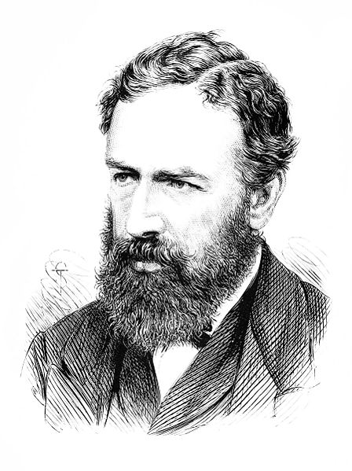
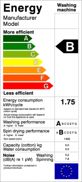

In 1865 the English economist William Stanley Jevons observed that the
technological improvements that increased the efficiency of coal use led to
an increase in the consumption of that mineral. Jevons argued that,
contrary to common intuition, technological improvements would not bring
about a reduction in fuel consumption.

The **Jevons paradox**, or the **Jevons effect**, says that as the
technology that increases the efficiency with which a resource is used gets
better, consumption of that resource is most likely to go up, not down.

In simple terms: more efficient engines, more fuel consumed. Energy
efficiency? The greater the energy efficiency, the greater the consumption,
and the need for new sources of power generation (dams, thermal power
plants, etc.)

Mathematically:

> If Ef \> Ei then Cf \< Ci, but Ci \* Ei \* Ni \<\< Cf \* Ef \* Nf
>
> -   E: is the efficiency of consumption
>
> -   N: is the number of consumers
>
> -   C: the instantaneous consumption
>
> -   i: indicates the initial state, f the final state.

Economists call it a paradox because it goes against the economic intuition
that greater efficiency implies lower consumption.

There is a parallel in information handling: the more efficiently we handle
information, the greater the demand to process information, and the more
new information gets generated, which needs to be processed in turn.
"Computers, instead of lightening our work, end up making us work
more" :wink:

In the eighties, in the first places I worked, there were 1 or 2 computers.
Today everybody has one. Energy consumption for computerization and support
of administrative work went up by one or two orders of magnitude.

In the 1980s, the economists Daniel Khazoom and Leonar Brookes postulated
that: _"energy efficiency improvements that, on the broadest
considerations, are economically justified at the microlevel, lead to
higher levels of energy consumption at the macrolevel."_

The Khazoom-Brookes postulate was analyzed by
[Harry Saunders](http://www.allbusiness.com/utilities/339669-1.html) in 1992,
who found the conditions under which this hypothesis holds, following the
analysis of
[neoclassical economic growth theory](http://es.wikipedia.org/wiki/Modelo_de_crecimiento_de_Solow).

In other words, the idea that efficiency is the solution to our energy
consumption problems is of doubtful validity. The only way to slow the
growth in energy consumption would be to shrink the economy, that is, to
stop growing. Another way is to intervene directly in the market to
regulate consumption, with taxes, for example.

There are economists who suggest that what should be done is to tax energy
consumption, and that those taxes can be reinvested in the restoration of
*"natural capital".*

What the Jevons effect tells us is that the idea of energy efficiency alone
is not enough, and that sustainable energy policies need other kinds of
government intervention.

The question is whether the authorities are aware of this effect, and
whether those who promote energy efficiency as the only solution to the
problem are too.

By the way, this shows up in the rebound effect, which worries a number of
economists, and certainly groups like the
[BreakThrough Institute](http://thebreakthrough.org/index.shtml), which in
February published [a report](http://thebreakthrough.org/blog/2011/02/new_report_how_efficiency_can.shtml)
studying this phenomenon.
