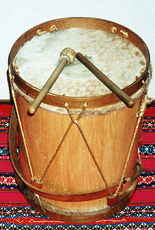
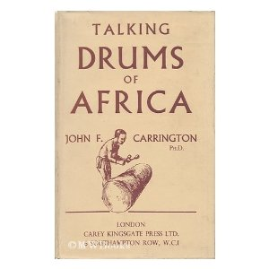

> "The fundamental problem of communication is that of reproducing at one
> point either exactly or approximately a message selected at another
> point. Frequently the messages have meaning." \
> -- Claude Shannon

When I was a teenager I was given a **bombo legüero**, a big Argentine
folk drum that I still have. It's called legüero because they say that,
under the right conditions, its sound can be heard a league away (between
4 and 5 kilometers).

The drum is an ancient form of communication. We have bells, and other
kinds of percussion instruments, like triangles or the gong, which let us
announce events with signals: fire!, time to eat!, the royalists are
coming!, etc. Armies learned to make signals tied to drum rolls, and so
on. But the most remarkable of all these forms of communication is the
African talking drums.

## **Drums that talk**

Talking with drums was not simple:

> The drummer would not say, "Come back home", but rather,
> "Make your feet come back the way they went, make your
> legs come back the way they went,\
> plant your feet and your legs again,\
> in the village we belong to."\
> -- James Gleick

James Gleick, in his book [The Information: A History, a Theory, a
Flood](https://www.amazon.com/gp/product/0375423729/ref=as_li_qf_sp_asin_tl?ie=UTF8&tag=lanaturaledel-20&linkCode=as2&camp=217145&creative=399349&creativeASIN=0375423729),
tells us the story of how the rest of the world came to understand the
mystery of the African talking drums. Although many explorers and
travelers had heard the sub-Saharan drums, nobody knew they carried
information, that they were in fact talking.

In the middle of the 19th century, on an expedition to the Niger River
organized by the "Society for the Extinction of the Slave Trade", Captain
William Allen made an important discovery by paying attention to his
Cameroonian pilot, whom he called Glasgow. They were in the ship's cabin
when the captain noticed that his pilot was lost in thought, listening to
the drums. "Don't you hear my son speak?", Glasgow asked him. Since they
had heard no voices, they asked him how he knew his son was speaking to
him. "The drum speaks to me, it tells me to come up on deck." The
astonishment grew, and the captain wrote down for the first time the
incredible communication capabilities of these drums, which could
transmit messages over great distances. A technology that had not yet
been developed in Europe: the ability to send messages faster than
messengers on horseback.

Explorers and missionaries began to record and transcribe these
messages.

> The announcement of a birth in Bolenge, a village in the Belgian Congo,
> went like this: *Batoko fala fala, tokema bolo bolo, boseka woliana imaki
> tonkilingonda, ale nda bobila wa fole fole, asokoka l\'isika koke
> koke.*
> The mats are rolled up, we feel strong, a woman came
> from the forest, she is in the open village, that is enough for
> its time.
>
> A missionary, Roger T. Clarke, transcribed this call to a
> fisherman's funeral:
>
> *La nkesa laa mpombolo, tofolange benteke biesala, tolanga bonteke
> bolokolo bole nda elinga l\'enjale baenga, basaki l\'okala bopele
> pele. Bojende bosalaki lifeta Bolenge wa kala kala, tekendake
> tokilingonda, tekendake beningo la nkaka elinga l\'enjale. Tolanga
> bonteke bolokolo bole nda elinga l\'enjale, la nkesa la mpombolo.*
>
> In the morning at dawn, we do not want to gather for work,
> we want a meeting of play on the river. Men who live in
> Bolenge, do not go to the forest, do not go fishing. We want a meeting
> of play on the river, in the morning at dawn."

Why are these drum messages so grandiloquent, and apparently so
inefficient?

We owe the explanation to the work of John F. Carrington, an English
missionary born in 1914.  At 24 he set off for Africa and settled on that
continent for life. He discovered that the drums did not use a system of
signals; there was no code, to put it in modern terms, in these
transmissions. The drums transmitted poetry, prayers, even jokes. The
drums were literally used to talk.

Carrington learned to play the drums; in particular he mastered Kele, a
language of the
[Bantu](https://en.wikipedia.org/wiki/Bantu_languages) family, from
eastern Zaire. The natives said he wasn't really European: despite his
color, Carrington was one of them. That when he died the gods had sent his
soul by mistake to England, into the body of a baby. But since he was
African he couldn't help coming back. Generously, the villagers said that
if his drum messages sometimes sounded odd, it was because of the poor
education the whites had given him.

Carrington became a linguistic authority on the structure of the African
language families. He published his discoveries in 1949 in a book titled
"The Talking Drums of Africa".

To understand the mystery of the talking drums you have to know the
structure of African languages. They are tonal languages, where meaning is
determined by the rise or fall in pitch when vowels or consonants are
pronounced. Our language has no pitch changes of this kind, except when we
ask a question or exclaim. We pronounce "you're happy?" differently from
"you're happy"; in the question there is a slight rise in pitch at the end
of the phrase. That is what African languages apply to all their vowels
and consonants.

For example, the word *lisaka, \_pronounced with all three syllables low
means \_puddle*; pronounced with a rising tone on the last syllable,
without necessarily stressing or accenting it, it means *promise*; and
pronounced another way it can mean *poison*.

Carrington observed how comical the confusion can be:

> alambaka boili \[-*\--* \_ \_\] = he watched the riverbank alambaka
> boili \[\-\-\-- \_ - \_ \] = he boiled his mother-in-law

The drum transmits the tone, but not the pitch, which is why in the
language of the drums the consonants are transmitted represented by the
different tones of the different drums. The problem is that this produces
ambiguities: for example, two high drum tones in Kele can be *sango*,
which means father, or *songe*, which means moon. To avoid this ambiguity,
additional words are introduced to make up a phrase that lets the word be
identified. For example, to say the moon, the phrase "*songe li tange la
manga*" ("the moon looks down at the earth") is used. The extra beats
provide context.
[Listen to a sample of the sound of the talking drums](https://www2.si.umich.edu/chico/instrument/sounds/tdrum.aiff)

What these extra sounds do is introduce additional bits of information to
correct and disambiguate the message. **Redundancy, though inefficient,
keeps the message from being confused**.

Above all when we are in a noisy environment. In radio communications, for
example, between airplane pilots and control towers, a language that
introduces redundancy is used to reduce errors. Instead of saying E C T,
you say Echo, Charlie, Tango.



After publishing his book, Carrington came across a mathematical formula
that helps explain this need for redundancy. In 1928 a
[paper](https://www.dotrose.com/etext/90_Miscellaneous/transmission_of_information_1928b.pdf)
by a Bell Labs engineer, Ralph Hartley, set out the formula:

    H = n log s = log sn

where H is the amount of information, n is the number of symbols in a
message, and s is the number of symbols available in the language.

What this formula says is that the fewer symbols you have available, the
more of them must be transmitted for a given amount of information. In the
case of the talking drums, the messages have to be at least eight times
longer than their spoken counterparts.

Although Hartley's work concentrated on coded languages, like Morse code,
he thought it could be generalized to every kind of communication, written
or spoken, as well as to the physical transmission of sound by
electromagnetic waves. Hartley, of course, knew nothing about African
drums. It would be a young colleague of his at Bell Labs who took up that
challenge by working out a theory of information. We mean Claude Shannon,
whose work we will look at another time.

Carrington began to understand that technological advances would make the
talking drums disappear from the African scene. He saw how the Lokele
youth practiced the drums less and less. In 1954 an American visitor found
him running a mission school in the Congolese outpost of Yalemba.
Carrington still went walking deep into the jungle, and when it was time
for lunch his wife would summon him with a quick roll on the drums that
said:

> "White man, spirit in the forest, come, come to the house of the
> tall shrubs above the spirit of the white man in the forest. The
> woman with the yams waits. Come, come."

The quoted texts are taken from the first chapter of the book [The
Information: A History, a Theory, a
Flood](https://www.amazon.com/gp/product/0375423729/ref=as_li_qf_sp_asin_tl?ie=UTF8&tag=lanaturaledel-20&linkCode=as2&camp=217145&creative=399349&creativeASIN=0375423729)
by James Gleick. The image of Carrington's book is taken from Amazon;
unfortunately the book is not available.

This [Wikipedia
article](https://en.wikipedia.org/wiki/Tonal_language) (in English)
describes tonal languages.
