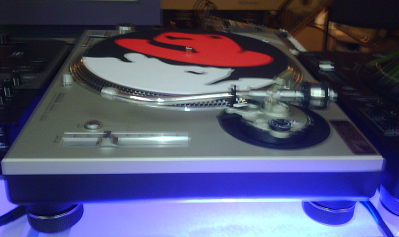

This week I have the chance to attend the RedHat Summit and JBoss
World Event in Boston. I plan to cover some interesting topics from
this event on the blog, so my more techie readers should stay tuned.

**Update**

-   Red Hat launches its PaaS, Platform as a Service, just today. It's
    called*\* [OpenShift](http://openshift.redhat.com/app/)*\*
