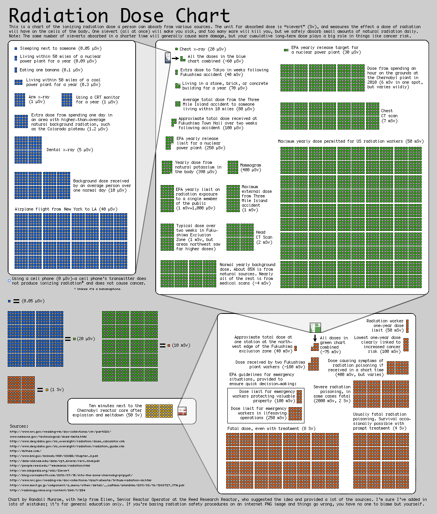

Even when you sleep next to someone you are exposed to 0.05
microsieverts of radiation.

This chart, put together by Randall Munroe, the author of
[XKCD](http://www.xkcd.com/), explains the radiation scale and gives us
some perspective on these measurements.

[Original image](http://xkcd.com/radiation/).
